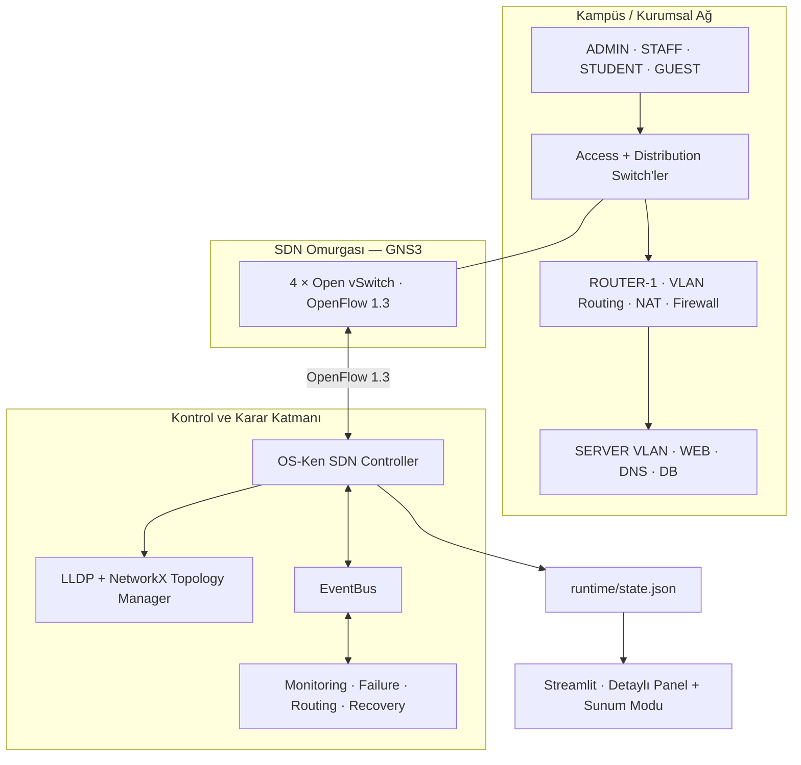
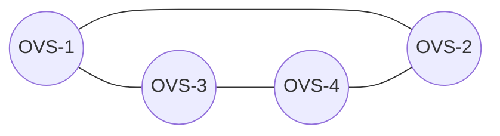
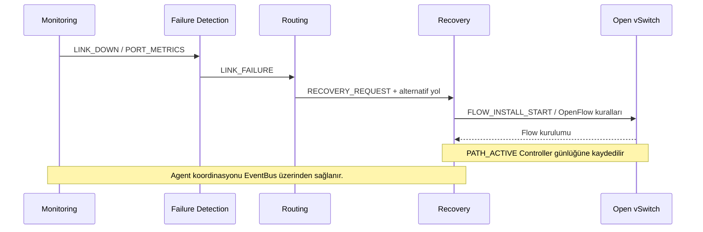

<div align="center">

# 🌐 Smart SDN

### Multi-Agent Self-Healing Campus Network

**GNS3 üzerinde kurumsal/kampüs ağı · Dinamik SDN yönlendirme · Otomatik arıza tespiti ve kurtarma**

[](./README.md)


**GNS3** · **Open vSwitch** · **OS-Ken** · **NetworkX** · **Python** · **Streamlit**

> **Temel hedef:** Ağdaki bir bağlantı arızalandığında bunu otomatik tespit etmek, kullanılabilir başka bir yol hesaplamak, OpenFlow kurallarıyla trafiği bu yola yönlendirmek ve bağlantı düzeldiğinde normal yönlendirmeye kontrollü şekilde dönmek.

</div>

---

## 📌 Projeye genel bakış

Geleneksel ağlarda bağlantı kopması, elle müdahale gerektiren veya belirli protokollerin yakınsama süresine bağlı kesintilere yol açabilir. **Smart SDN**, ağın kontrol mantığını merkezi bir SDN Controller üzerinde toplayarak bu süreci gözlemlenebilir ve otomatik bir iş akışına dönüştüren deneysel bir sistemdir.

Proje, basit bir SDN laboratuvarından başlayıp **VLAN'larla bölünmüş bir kampüs ağına** genişletilmiştir. Kurumsal tarafta access/distribution katmanları, router, NAT, güvenlik kuralları ve sunucular bulunur. SDN omurgasında ise **dört Open vSwitch**, **OS-Ken Controller** tarafından OpenFlow 1.3 ile yönetilir.

Sistemin ana bileşenleri:

- **Dinamik topoloji:** Switch'ler DPID, bağlantılar LLDP ile keşfedilir; ağ NetworkX graph'ı olarak tutulur.
- **Dört uzmanlaşmış agent:** Monitoring, Failure Detection, Routing ve Recovery; olay tabanlı bir EventBus ile birlikte çalışır.
- **Self-healing:** Arızalı bağlantı hariç tutularak alternatif rota seçilir ve uygun OpenFlow kuralları uygulanır.
- **Failback:** Bağlantı geri geldiğinde geçici recovery kuralları kontrollü şekilde temizlenir.
- **Canlı gözlem:** Streamlit dashboard ile topoloji, agent durumları, port metrikleri ve arıza–kurtarma zaman çizelgesi gösterilir.

### Proje özeti

| Bileşen | Güncel demo durumu |
|:--|:--|
| SDN Controller | OS-Ken · OpenFlow 1.3 |
| SDN omurgası | **4 Open vSwitch / 4 keşfedilen omurga bağlantısı** (sağlıklı durumda) |
| Multi-Agent yapı | **4 agent** · EventBus ile haberleşme |
| Ağ topolojisi | GNS3 üzerinde VLAN'lı kurumsal/kampüs modeli |
| Self-healing | Arıza tespiti, alternatif yol, OpenFlow recovery, failback |
| Arayüz | **Detaylı Panel + Sunum Modu** |
| Offline doğrulama | **41 test başarılı** (7 Failure + 11 Routing + 17 Recovery + 6 Runtime) |
| Mevcut geliştirme aşaması | **Aşama 7 tamamlandı; 7.7 Sunum Arayüzü hazır** |

> **Önemli ayrım:** Bu sürümde agent'lar **kural ve algoritma tabanlıdır**. Makine öğrenmesi veya yapay zekâ ile anomali tespiti henüz eklenmemiştir; ileri aşamalar için planlanmaktadır.

---

## 🧭 İçindekiler

1. [Mimari](#-sistem-mimarisi)
2. [Kampüs ağı ve servisler](#-kampüs-ağı-ve-servisler)
3. [Multi-Agent mimari](#-multi-agent-mimari)
4. [Self-healing nasıl çalışıyor?](#-self-healing-nasıl-çalışıyor)
5. [Canlı deney ve sonuçlar](#-canlı-deney-ve-doğrulamalar)
6. [Dashboard ve Sunum Modu](#-dashboard-ve-sunum-modu-aşama-77)
7. [Kurulum ve çalıştırma](#-kurulum-ve-çalıştırma)
8. [Testler](#-testler)
9. [Dosya yapısı](#-proje-yapısı)
10. [Yol haritası](#-geliştirme-yol-haritası)
11. [Sınırlar ve sonraki çalışmalar](#-mevcut-sınırlar-ve-sonraki-çalışmalar)

---

## 🏗️ Sistem mimarisi

Aşağıdaki şema **mantıksal mimariyi** özetler. Gerçek GNS3 bağlantıları ve port numaraları çalışma sırasında keşfedilir; yönlendirme kodunda sabit `path1/path2` rotaları kullanılmaz.



### Dinamik keşif ve topoloji

- Switch keşfi: **OpenFlow bağlantısı ve DPID**.
- Link keşfi: **LLDP** (`osken-manager --observe-links`).
- Topoloji saklama: [`topology/topology_manager.py`](topology/topology_manager.py) içindeki **NetworkX graph**.
- Yönlendirme: Güncel graph üzerinde alternatif/en kısa uygun yol hesabı.
- Güncelleme: Link eklendiğinde, koptuğunda veya switch ayrıldığında graph ve ilgili kararlar yenilenir.

Örnek sağlıklı omurga (GNS3 test topolojisi):



**Sağlıklı durumda gözlemlenen değer:** `node_count=4`, `edge_count=4`.

---

## 🏫 Kampüs ağı ve servisler

GNS3 topolojisi, SDN omurgasının çevresinde gerçekçi bir kurumsal ağ senaryosu oluşturur. Kullanıcı cihazları normal Ethernet **Access/Distribution** switch'lerine, SDN omurgası ise **Open vSwitch** cihazlarına bağlanır.

### VLAN planı

| VLAN | Kullanıcı / servis grubu | Alt ağ | Gateway |
|:--:|:--|:--|:--|
| 10 | ADMIN | `10.10.10.0/24` | `10.10.10.1` |
| 20 | STAFF | `10.10.20.0/24` | `10.10.20.1` |
| 30 | GUEST | `10.10.30.0/24` | `10.10.30.1` |
| 40 | STUDENT | `10.10.40.0/24` | `10.10.40.1` |
| 50 | SERVER | `10.10.50.0/24` | `10.10.50.1` |

**ROUTER-1**, Router-on-a-Stick alt arayüzleriyle VLAN'lar arası Layer-3 yönlendirmeyi sağlar. Ayrıca **nftables** üzerinden NAT ve stateful firewall/rol bazlı erişim kuralları uygulanır. Misafir ağının kurumsal iç ağlara erişimi sınırlandırılır; personel ve öğrenci ağları belirlenen sunucu servislerine ulaşabilir.

### Sunucu altyapısı

| Sunucu | IP | Teknoloji / görev |
|:--|:--|:--|
| **WEB-SERVER** | `10.10.50.10` | `lighttpd` · test web servisi |
| **DNS-SERVER** | `10.10.50.53` | `dnsmasq` · yerel DNS çözümleme |
| **DB-SERVER** | `10.10.50.20` | MariaDB · `smart_sdn` veritabanı |

Yerel DNS kayıtları arasında `web.sdn.test` ve `db.sdn.test` bulunur. **WEB → DNS → DB** akışıyla gerçek MariaDB sorgusu (`network_status` tablosu) doğrulanmıştır. Servis başlatma ve yapılandırma dosyaları [`configs/`](configs/) altında düzenlenmiştir.

> **Not:** `PC1` (`10.0.0.1`) ve `PC2` (`10.0.0.2`), özellikle SDN omurgasında failover denemeleri için kullanılan **ayrı test uçlarıdır**; kurumsal kullanıcı VLAN'larıyla karıştırılmamalıdır.

---

## 🤝 Multi-Agent mimari

Sistem tek bir büyük karar fonksiyonu yerine, **her biri belirli bir işten sorumlu dört agent** kullanır. Agent'lar [`utils/event_bus.py`](utils/event_bus.py) üzerinden olay yayınlayıp ilgili olaylara abone olur.

| Agent | Dosya | Sorumluluk |
|:--|:--|:--|
| **01 · Monitoring** | [`monitoring_agent.py`](agents/monitoring_agent.py) | Link/port durumlarını ve OpenFlow PortStats verilerini izler; RX/TX, throughput, paket hızı, drop/error sayaçlarını işler. |
| **02 · Failure Detection** | [`failure_agent.py`](agents/failure_agent.py) | `HEALTHY`, `DEGRADED`, `FAILED` durumlarını değerlendirir; gerçek link arızasını `LINK_FAILURE` ile doğrular. |
| **03 · Routing** | [`routing_agent.py`](agents/routing_agent.py) | Güncel NetworkX graph'ında arızalı bağlantıyı dışlayarak uygun alternatif yolu hesaplar. |
| **04 · Recovery** | [`recovery_agent.py`](agents/recovery_agent.py) | Bilinen host trafiğine özel OpenFlow kurallarını yükler; kurtarma oturumunu ve failback'i yönetir. |



**Neden bu mimari?** İzleme, hata kararı, rota seçimi ve uygulama birbirinden ayrıldığı için bileşenler bağımsız test edilebilir; sistem ileride yeni politika veya öğrenme tabanlı agent'larla genişletilebilir.

---

## 🔁 Self-healing nasıl çalışıyor?

### 1. Normal çalışma

Controller, dört Open vSwitch'i ve omurga linklerini keşfeder. Trafik mevcut topoloji üzerinden iletilir.

### 2. Arıza tespiti

GNS3'te bir omurga linki **Suspend** edildiğinde Monitoring Agent `LINK_DOWN` üretir. Failure Detection Agent port/link durumunu değerlendirerek arızayı `LINK_FAILURE` olarak doğrular.

### 3. Alternatif rota

Routing Agent, arızalı bağlantıyı graph hesabından çıkarır. Örneğin doğrudan **OVS-1 ↔ OVS-2** linki kesilirse mevcut topolojiye göre şu rota seçilebilir:

`OVS-1 → OVS-3 → OVS-4 → OVS-2`

Bu bir **örnek test rotasıdır**; kod sabit bir yolu zorunlu kılmaz.

### 4. Trafiği yeniden yönlendirme

Recovery Agent, uygun ve **bilinen unicast host çiftleri** için seçilen yol boyunca OpenFlow kuralları oluşturur. Kurallar:

- `in_port + eth_src + eth_dst` eşleşmesini kullanır; sınırsız wildcard yönlendirme yapılmaz.
- Kurtarma kuralları için **`cookie=0x6E`** ve **`priority=100`** kullanılır.
- Normal MAC learning ve LLDP/table-miss kurallarından ayrı yönetilir.
- Kurulum başarısız olursa kısmi kurallar geri alınabilir.

Günlükte örnek olay akışı:

```text
[MONITORING] LINK_DOWN
[FAILURE] LINK_FAILURE
[ROUTING] ALTERNATIVE_PATH
[RECOVERY] REQUEST
[RECOVERY] FLOW_INSTALL_START
[RECOVERY] FLOW_INSTALLED
[RECOVERY] PATH_ACTIVE
```

### 5. Bağlantının geri gelmesi ve failback

Koparılan bağlantı **Resume** edildiğinde topoloji yenilenir. Failback koşulları sağlandığında Recovery Agent geçici kurtarma kurallarını temizler ve normal yönlendirmeye dönüşü yönetir. Kurtarma yolunda ayrıca bir arıza oluşursa oturum **`SESSION_INVALIDATED`** ile geçersiz kılınabilir.

> Her arıza mutlaka kurtarılabilir değildir: **alternatif yol yoksa** `NO_ALTERNATIVE_PATH`, **etkilenen bilinen host trafiği yoksa** `SKIPPED` görülebilir. Bu, sahte bir başarı göstermek yerine sistemin kararını açıkça kaydetmesini sağlar.

---

## 🧪 Canlı deney ve doğrulamalar

### Deney senaryosu: bağlantı kesintisi → kurtarma → normale dönüş

1. GNS3 topolojisi ve Controller çalıştırılır: **4 switch / 4 aktif bağlantı**.
2. PC1 üzerinden PC2'ye trafik başlatılır: `ping 10.0.0.2`.
3. OVS omurgasındaki uygun bir bağlantı GNS3'te **Suspend** edilir.
4. Dashboard'da arızalı link kırmızı, bulunan kurtarma yolu yeşil görünür.
5. Controller alternatif yolu hesaplar; Recovery Agent'a ait flow kuralları OVS üzerinde görüntülenebilir.
6. PC1–PC2 ping çıktısında **kısa süreli timeout'lar**, ardından **yeniden gelen yanıtlar** gözlemlenmiştir.
7. Link **Resume** edilince topoloji tekrar **4 bağlantıya** ulaşır ve failback adımları izlenir.

| Gözlem | Doğrulama |
|:--|:--|
| Dinamik link keşfi | `TOPOLOGY_GRAPH node_count=4 edge_count=4` |
| Arızalı linkin graph'tan çıkarılması | Örnek testte `edge_count: 4 → 3` |
| Alternatif yolun hesaplanması | `ALTERNATIVE_PATH` |
| OpenFlow kurtarma kuralları | `FLOW_INSTALLED`, `PATH_ACTIVE`; gerçek OVS tablolarında `cookie=0x6e`, `priority=100` |
| Trafiğin yeniden ulaşması | PC1 → PC2 ping yanıtlarının geri gelmesi |
| Normal duruma dönüş | `PORT_RECOVERED`, `FAILBACK_COMPLETE` ve/veya `RECOVERY_FLOWS_REMOVED` olayları |
| Offline testler | **41/41 başarılı** |

**Sunum Modu'nda gözlenen bir olayda** arızanın algılanmasından kurtarma yolunun etkinleştirilmesine kadar **3,0 ms Controller iç tepki süresi** gösterilmiştir. Bu değer **uçtan uca paket kaybı, ping gecikmesi veya garantili failover süresi değildir**; tek bir olayın uygulama içi zaman damgalarından hesaplanmıştır. Ayrı bir deney serisiyle istatistiksel performans ölçümü yapılması sonraki aşamadadır.

---

## 📊 Dashboard ve Sunum Modu (Aşama 7.7)

Aşama 7.7'de mevcut Streamlit paneline, **akademik sunum sırasında sistemin çalışma mantığını tek ekrandan anlatmaya yönelik Sunum Modu** eklenmiştir.

**Sunum Modu** (`?mode=sunum`):

- **KPI kartları:** Controller, aktif switch, aktif bağlantı, aktif arıza, Recovery durumu.
- **Canlı ağ haritası:** Sağlıklı bağlantılar mavi, kopmuş linkler kırmızı kesikli, etkin recovery yolu yeşil.
- **Agent zinciri:** Monitoring → Failure Detection → Routing → Recovery ve güncel durumları.
- **Self-healing zaman çizelgesi:** Arıza algılama, doğrulama, yol hesaplama, flow kurulumu, alternatif yolun etkinleşmesi, link dönüşü ve failback.
- **Olay açıklaması:** Son arıza / son kurtarma ile **güncel olay** ve **geçmiş olay** ayrımı.

**Detaylı Panel**:

- Link/port durumları, RX/TX, throughput, paket hızı, drop/error metrikleri.
- Trafik grafikleri, OVS envanteri ve Controller bağlantıları.
- Agent istatistikleri, incident geçmişi ve filtrelenebilir olay günlüğü.

**Teknik yaklaşım:** Controller, verileri [`utils/runtime_state.py`](utils/runtime_state.py) aracılığıyla atomik olarak `runtime/state.json` dosyasına yazar. Dashboard bu dosyayı **salt okunur** biçimde izler; controller'ı başlatmaz ve switch yapılandırmalarını değiştirmez. Dashboard'un arayüz kodu [`dashboard/app.py`](dashboard/app.py) içindedir; Sunum Modu bileşeni [`dashboard/presentation.py`](dashboard/presentation.py) ile ayrılmıştır.

```bash
# Controller ve GNS3 zaten çalışıyorken, ayrı terminalde:
cd ~/smart-sdn-gns3
./start_dashboard.sh
```

- **Detaylı Panel:** `http://127.0.0.1:8501/`
- **Sunum Modu:** `http://127.0.0.1:8501/?mode=sunum`

> **Demo notu:** Arayüzdeki süreler Controller içindeki olay zamanlarını temsil eder. OVS üzerinde kurtarma flow'u bulunması ve PC1–PC2 ping testi, işleyişi doğrulamak için ayrı ayrı kontrol edilmelidir.

---

## 🚀 Kurulum ve çalıştırma

### Gereksinimler

- Ubuntu 22.04 tabanlı Linux ortamı (projede VirtualBox VM kullanıldı).
- **GNS3 2.2.x** ve projede kullanılan Docker/VPCS düğümlerinin kurulumu.
- Docker, Open vSwitch destekli GNS3 image'ları, **OS-Ken**, Python 3 ve NetworkX.
- Dashboard için Streamlit, Plotly ve pandas (sürümler: [`dashboard/requirements.txt`](dashboard/requirements.txt)).

> GNS3 proje dosyası [`gns3/Smart_SDN_MultiAgent_v2_Work.gns3`](gns3/Smart_SDN_MultiAgent_v2_Work.gns3) depodadır. **GNS3 image/container kurulumları, sistem servisleri ve kalıcı runtime verileri repo içeriğinden bağımsızdır**; başka bilgisayarda çalıştırmak için aynı ortamın hazırlanması gerekir.

### 1 · Depoyu hazırla

```bash
git clone https://github.com/betulaltunyuva/smart-sdn-gns3.git
cd smart-sdn-gns3
```

### 2 · GNS3 topolojisini başlat

GNS3'te ilgili proje dosyasını aç; gerekli Docker, router, server ve test PC düğümlerini başlat. Önce cihazların düzgün çalıştığını ve Docker'ın erişilebilir olduğunu doğrula.

### 3 · SDN Controller'ı başlat

```bash
./start_sdn.sh
```

Script çalışan GNS3 OVS container'larını keşfeder, yönetim portlarını/IP'lerini kontrol eder, OpenFlow 1.3 ile Controller hedefini yapılandırır ve **başka Controller zaten varsa ikinci bir örnek oluşturmamaya** çalışır.

```bash
# Controller'ı başlatmadan yalnızca OVS yapılandırmasını çalıştırmak için:
./start_sdn.sh --no-controller

# Controller günlüğü:
tail -f logs/controller.log
```

**Bu test ortamındaki Controller hedefi:** `192.168.122.1:6653`. Adres, farklı bilgisayar/VM kurulumlarında değişebilir.

### 4 · Dashboard'u aç

```bash
python3 -m venv .venv
.venv/bin/pip install -r dashboard/requirements.txt
./start_dashboard.sh
```

Dashboard başlatıcısı mevcut uygun Streamlit kurulumunu kullanır. Controller'dan **ayrı terminalde** çalıştırılmalıdır.

### 5 · Test trafiği oluştur

PC1 VPCS konsolundan:

```text
PC1> ping 10.0.0.2
```

Sağlıklı durumda yanıtları gözlemle. Ardından GNS3'te **tek bir omurga bağlantısını** Suspend/Resume ederek canlı topoloji, agent olayları ve ping tepkilerini izle.

### Kaydedilmiş VM durumundan geri dönüş notu

VirtualBox'ın **"Makinenin Durumunu Kaydet"** özelliğiyle açılan oturumlarda GNS3 Docker container'ları ve Controller çalışır görünse bile OVS **yönetim IPv4 adresleri** yeniden alınmak zorunda kalabilir. Sorun teşhisinde:

1. `virbr0` ve DHCP ağı durumunu kontrol et.
2. OVS yönetim arayüzünün IPv4 adresini ve `ovs-vsctl ... is_connected` değerini doğrula.
3. Controller sürecini ve 6653 dinleyicisini kontrol et; gereksiz ikinci Controller çalıştırma.
4. `start_sdn.sh` kilitliyse kilit dosyasını rastgele silme veya çalışan Controller'ı sonlandırma.

Bu uyarı, belirli bir laboratuvar oturumunda gözlemlenen yeniden başlatma/VM resume davranışı içindir; her sistemde aynı sorun oluşmaz.

---

## ✅ Testler

Agent ve runtime bileşenleri, GNS3 gerektirmeyen offline testlerle denetlenir.

```bash
cd ~/smart-sdn-gns3
PYTHONPATH=. python3 tests/test_failure_agent_offline.py
PYTHONPATH=. python3 tests/test_routing_agent_offline.py
PYTHONPATH=. python3 tests/test_recovery_agent_offline.py
PYTHONPATH=. python3 tests/test_runtime_state_offline.py
```

| Test dosyası | Başarılı test |
|:--|--:|
| `test_failure_agent_offline.py` | 7 |
| `test_routing_agent_offline.py` | 11 |
| `test_recovery_agent_offline.py` | 17 |
| `test_runtime_state_offline.py` | 6 |
| **Toplam** | **41** |

Bu testler; arıza/port sağlığı, alternatif yol, flow izolasyonu, failback/oturum yönetimi ve runtime durum çıktısının farklı senaryolarını içerir. **Offline test başarısı, tek başına gerçek ağdaki performans veya tüm GNS3 senaryolarının doğrulandığı anlamına gelmez.** Bu nedenle canlı GNS3 ve trafik testleri ayrıca yapılmıştır.

---

## 🗂️ Proje yapısı

```text
smart-sdn-gns3/
├── agents/
│   ├── monitoring_agent.py        # Ağ/port izleme
│   ├── failure_agent.py           # Arıza ve sağlık kararı
│   ├── routing_agent.py           # Dinamik alternatif rota
│   └── recovery_agent.py          # OpenFlow recovery ve failback
├── controller/
│   └── sdn_controller.py          # OS-Ken ve OpenFlow olayları
├── topology/
│   └── topology_manager.py       # NetworkX topolojisi
├── utils/
│   ├── event_bus.py              # Agent haberleşmesi
│   └── runtime_state.py          # Atomik canlı durum çıktısı
├── dashboard/
│   ├── app.py                    # Streamlit detaylı panel / mod seçimi
│   ├── presentation.py           # Aşama 7.7 Sunum Modu
│   ├── state_reader.py           # Salt okunur durum okuyucu
│   └── requirements.txt
├── configs/
│   ├── router/                  # VLAN, NAT ve firewall
│   ├── dns/                     # dnsmasq
│   ├── web/                     # lighttpd
│   └── db/                      # MariaDB
├── gns3/
│   └── Smart_SDN_MultiAgent_v2_Work.gns3
├── tests/                       # 41 offline test
├── start_sdn.sh                 # SDN başlangıç otomasyonu
├── start_dashboard.sh           # Dashboard başlatıcı
├── HAFTALIK_GELISME.md          # Haftalık demo notları
└── README.md
```

`logs/`, `runtime/`, sanal ortamlar, GNS3 geçici verileri ve hassas dosyalar `.gitignore` kapsamındadır. **Token, parola, özel anahtar ve diğer secret'lar repoya eklenmemelidir.**

---

## 🗺️ Geliştirme yol haritası

| Aşama | Kapsam | Durum |
|:--:|:--|:--:|
| 0 | Çalışan sürümü koruma | ✅ |
| 1–4 | Kampüs ağı, VLAN, routing, NAT, firewall, sunucular | ✅ |
| 5 | SDN switch mimarisi ve OpenFlow 1.3 | ✅ |
| 6 | Dinamik topoloji, LLDP ve routing doğrulamaları | ✅ |
| **7** | **Multi-Agent entegrasyonu, arıza–recovery–failback doğrulaması** | **✅** |
| **7.7** | **Canlı sunum arayüzü ve self-healing zaman çizelgesi** | **✅** |
| 8 | Ölçümlü self-healing deneyleri / performans analizi | ⏳ |
| 9 | İzleme metriklerinden veri seti üretimi | ⏳ |
| 10 | AI / anomali tespit agent'ı | ⏳ |
| 11 | Gelişmiş güvenlik ve politika senaryoları | ⏳ |
| 12 | Deneysel karşılaştırma ve akademik değerlendirme | ⏳ |

**Sunum için mevcut kapsam: Aşama 0–7.7.** Aşama 8 ve sonrası bu sürümde uygulanmış olarak gösterilmez.

---

## ⚠️ Mevcut sınırlar ve sonraki çalışmalar

- **Yapay zekâ bileşeni henüz yok:** Şimdiki multi-agent sistem ölçüm, kurallar, graph algoritmaları ve OpenFlow üzerine kuruludur.
- **Tepki süresi ≠ uçtan uca kesinti:** Dashboard'daki milisaniye değerleri Controller olayları arasındaki sürelerdir. Paket kaybı, jitter, ping RTT ve farklı yük koşulları Aşama 8'de ayrıca ölçülmelidir.
- **Kurtarma koşulludur:** Alternatif yol veya bilinen uygun host trafiği bulunmazsa recovery uygulanmayabilir; bu durum log ve arayüzde açıkça gösterilir.
- **Laboratuvar ortamı:** GNS3/Docker/VirtualBox üzerinde doğrulanan sonuçlar, üretim ortamında kesintisiz çalışma garantisi değildir.
- **Başlatma bağımlılıkları:** GNS3 image'ları, sanal ağ/DHCP, yönetim arayüzleri ve Docker ortamı uygun şekilde yapılandırılmış olmalıdır.

---

## 🎓 Sunumda nasıl gösterilir?

**Önerilen 5 dakikalık demo:**

1. **Başlangıç (30 sn):** Dashboard Sunum Modu'nu aç; Controller ONLINE, 4 switch, 4 bağlantı, 0 arıza.
2. **Mimari (45 sn):** Dört agent'ın sırasıyla ne yaptığını açıkla.
3. **Canlı arıza (2 dk):** PC1 → PC2 ping çalışırken bir omurga bağlantısını Suspend et. Kırmızı linki, alternatif yolu ve self-healing adımlarını göster.
4. **Failback (1 dk):** Bağlantıyı Resume et; topolojinin 4 linke dönmesini ve normal yönlendirmeye geçişi izle.
5. **Kapanış (45 sn):** OpenFlow flow doğrulamasını, 41 test sonucunu ve Aşama 8'de ölçülecek performans metriklerini özetle.

> **Projenin temel katkısı:** VLAN'lı kampüs ağı üzerinde, dinamik graph bilgisi ve olay tabanlı dört agent kullanarak **arıza algılama → yol hesaplama → OpenFlow uygulama → normale dönüş** zincirinin hem canlı trafikle hem de görsel arayüzle gösterilebilmesi.

---

<div align="center">

**Smart SDN · GNS3 · Multi-Agent Self-Healing**
*Mevcut demo kapsamı: Aşama 7.7 · 30 Ekim 2026*

</div>
