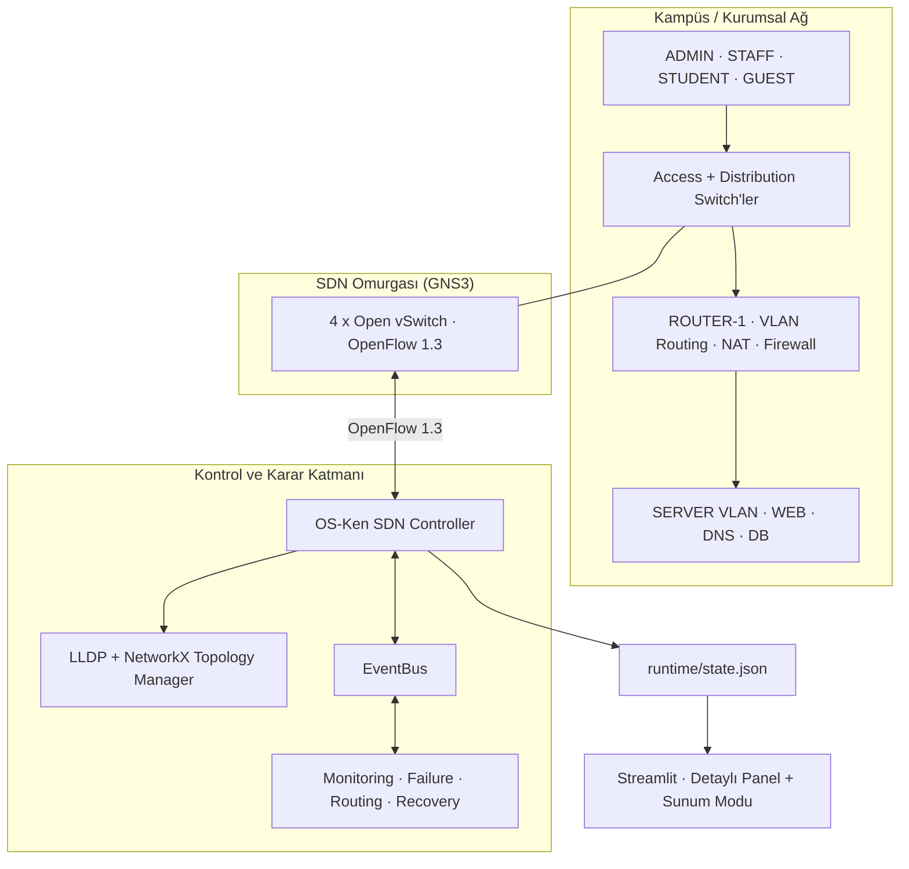
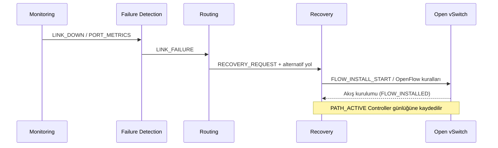
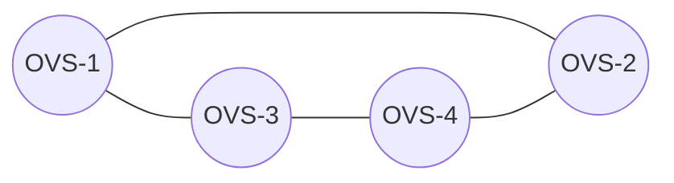
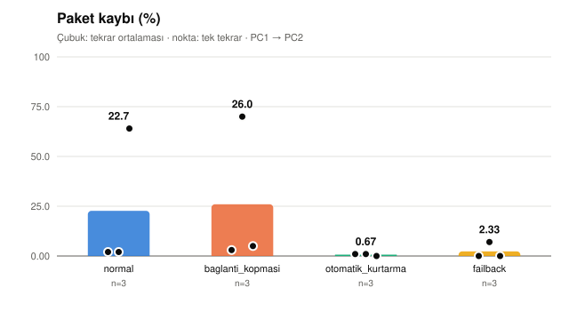
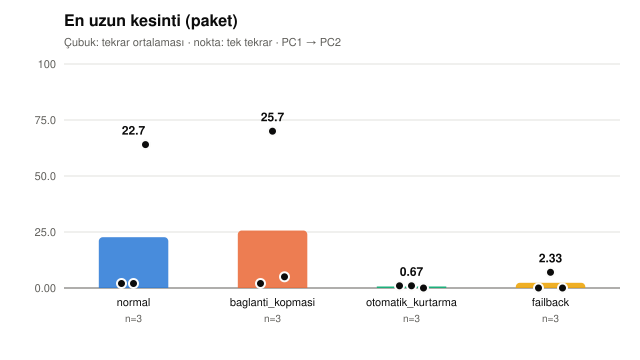
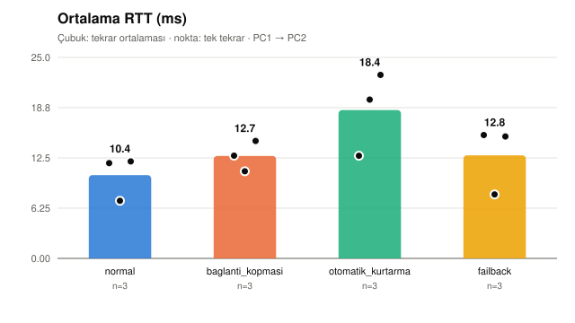
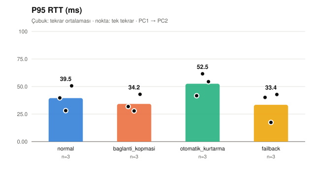
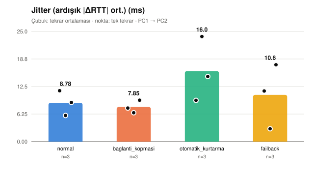

# Smart SDN: Multi-Agent Self-Healing Campus Network

**GNS3 üzerinde kurumsal/kampüs ağı, OpenFlow 1.3 tabanlı SDN omurgası ve dört ajanlı kural tabanlı arıza tespiti / otomatik kurtarma sistemi**


Smart SDN, bir omurga bağlantısı arızalandığında bunu Controller'ın otomatik tespit etmesini, kalan topolojide alternatif bir yol hesaplamasını, bu yolu OpenFlow kurallarıyla etkinleştirmesini ve bağlantı düzeldiğinde normal yönlendirmeye kontrollü biçimde dönmesini hedefleyen bir bitirme projesidir. Sistem GNS3 laboratuvarında çalışır; sonuçlar gerçek ağ ortamı için garanti değildir.

> **Dürüst özet.** Mekanizma (arıza onayı, alternatif yol, akış kurulumu, failback) çalışmaktadır ve canlı olarak gösterilmiştir. Aşama 8'de yapılan 12 ölçümlü deneyde ise sonuçlar karışıktır: 6 deney analiz programının ölçütlerine göre `BASARILI`, 6 deney `BASARISIZ` bulunmuştur; bir normal ağ denemesinde %64, bir bağlantı kopması denemesinde %70 paket kaybı yaşanmıştır. Ayrıntılar [Aşama 8 bölümünde](#16-aşama-8-performans-deneyleri) ve [sonuç raporunda](deneyler/ASAMA_8_SONUC_RAPORU.md) yer alır.
>
> **Güncel durum (24 Kasım 2026).** Aşama 9 kapsamında dört ağ durumu (NORMAL, LOAD, CONGESTION, FAILURE) için 6373 kayıtlık etiketli bir port-metrik veri seti toplanmıştır ([bölüm 19](#19-bu-hafta-aşama-8-özeti-ve-aşama-9-veri-toplama)). Bu veri seti henüz bir model eğitmek için yeterli değildir; **yapay zekâ modeli eğitilmemiş, Aşama 10'a geçilmemiştir.**

---

## İçindekiler

1. [Projenin amacı ve çözdüğü problem](#1-projenin-amacı-ve-çözdüğü-problem)
2. [Temel özellikler](#2-temel-özellikler)
3. [Sistem mimarisi](#3-sistem-mimarisi)
4. [Multi-Agent yapısı](#4-multi-agent-yapısı-ve-ajanların-görevleri)
5. [Ağ topolojisi](#5-ağ-topolojisi)
6. [Kullanılan teknolojiler](#6-kullanılan-teknolojiler)
7. [Projenin çalışma mantığı](#7-projenin-çalışma-mantığı)
8. [Arıza algılama ve otomatik kurtarma](#8-arıza-algılama-ve-otomatik-kurtarma-süreci)
9. [Failover ve failback](#9-failover-ve-failback-mekanizmaları)
10. [Dashboard](#10-dashboard-özellikleri)
11. [Kurulum gereksinimleri](#11-kurulum-gereksinimleri)
12. [Kurulum ve çalıştırma](#12-kurulum-ve-çalıştırma-adımları)
13. [Proje klasör yapısı](#13-proje-klasör-yapısı)
14. [Test ve doğrulama](#14-test-ve-doğrulama)
15. [Geliştirme aşamaları](#15-geliştirme-aşamaları)
16. [Aşama 8 performans deneyleri](#16-aşama-8-performans-deneyleri)
17. [Gerçek performans sonuçlarının özeti](#17-gerçek-performans-sonuçlarının-özet-tablosu)
18. [Performans grafikleri](#18-performans-grafiklerine-bağlantılar)
19. [Bilinen sorunlar ve sınırlamalar](#19-bilinen-sorunlar-ve-sınırlamalar)
20. [Gelecek geliştirmeler](#21-gelecek-geliştirmeler)
21. [Lisans ve proje bilgileri](#21-lisans-ve-proje-bilgileri)

---

## 1. Projenin amacı ve çözdüğü problem

Geleneksel ağlarda bir bağlantı kopması, protokol yakınsama süresine bağlı kesintilere ya da elle müdahaleye yol açabilir. Smart SDN, ağın kontrol mantığını merkezi bir SDN Controller'da toplayarak arıza yönetimini gözlemlenebilir, olay tabanlı ve otomatik bir iş akışına dönüştürmeyi amaçlar:

`arıza tespiti` → `arızanın doğrulanması` → `alternatif yol hesabı` → `OpenFlow ile yolun etkinleştirilmesi` → `bağlantı dönünce failback`

Proje, basit bir SDN laboratuvarından VLAN'larla bölünmüş bir kampüs ağı modeline genişletilmiştir. Kurumsal tarafta access/distribution katmanları, router, NAT, güvenlik kuralları ve sunucular; SDN omurgasında ise dört Open vSwitch bulunur.

> **Önemli ayrım.** Bu sürümde ajanlar **kural ve algoritma tabanlıdır.** Makine öğrenmesi veya yapay zekâ ile anomali tespiti henüz uygulanmamıştır (bkz. [Gelecek geliştirmeler](#21-gelecek-geliştirmeler)). Aşama 9'da yalnızca bu bileşen için veri toplama altyapısı kurulmuştur.

## 2. Temel özellikler

| Özellik | Açıklama |
|:--|:--|
| Dinamik topoloji keşfi | Switch'ler OpenFlow bağlantısı ve DPID ile, linkler LLDP ile keşfedilir; ağ NetworkX grafı olarak tutulur |
| Dört ajan | Monitoring, Failure Detection, Routing, Recovery; `EventBus` ile gevşek bağlı haberleşme |
| Arıza tespiti | `LINK_DOWN` olayı ve port sağlık sınıflandırması (`HEALTHY`, `DEGRADED`, `FAILED`); arıza `LINK_FAILURE` ile doğrulanır |
| Alternatif yol | Arızalı bağlantı grafikten çıkarılarak kalan topolojide en kısa uygun yol hesaplanır; sabit `path1/path2` yoktur |
| OpenFlow kurtarma | Bilinen host çiftleri için yol boyunca MAC'e özgü akışlar (`cookie=0x6E`, `priority=100`) |
| Failback | Bağlantı kararlı hâle geldikten sonra (`FAILBACK_STABLE_SECONDS = 10`) kurtarma akışları temizlenir |
| Canlı dashboard | Streamlit tabanlı Detaylı Panel ve Sunum Modu; Controller'a müdahale etmeyen salt okunur arayüz |
| Kampüs ağı modeli | 5 VLAN, router-on-a-stick, nftables ile NAT/güvenlik duvarı, WEB/DNS/DB sunucuları |
| Başlangıç otomasyonu | `start_sdn.sh` ile GNS3 OVS düğümlerinin bulunması ve Controller'a bağlanması |
| Offline testler | 41 ajan/runtime testi + 27 analiz aracı testi, GNS3 gerektirmez |
| Performans ölçüm altyapısı | Ping kaydı analizi, CSV üretimi ve SVG grafikler (`deneyler/`) |

## 3. Sistem mimarisi

Aşağıdaki şema mantıksal mimariyi özetler. Gerçek GNS3 bağlantıları ve port numaraları çalışma sırasında keşfedilir.



### Dinamik keşif ve topoloji

- **Switch keşfi:** OpenFlow bağlantısı ve DPID.
- **Link keşfi:** LLDP (`osken-manager --observe-links`). Bu bayrak verilmezse link olayları üretilmez.
- **Topoloji saklama:** [`topology/topology_manager.py`](topology/topology_manager.py) içindeki NetworkX grafı.
- **Yönlendirme:** Güncel graf üzerinde alternatif/en kısa uygun yol hesabı.
- **Durum çıktısı:** Controller, [`utils/runtime_state.py`](utils/runtime_state.py) ile durumu atomik olarak `runtime/state.json` dosyasına yazar.

## 4. Multi-Agent yapısı ve ajanların görevleri

Sistem tek bir büyük karar fonksiyonu yerine, her biri ayrı bir işten sorumlu dört ajan kullanır. Ajanlar birbirini doğrudan çağırmaz; [`utils/event_bus.py`](utils/event_bus.py) üzerinden olay yayınlar ve abone olur.

| Ajan | Dosya | Sorumluluk |
|:--|:--|:--|
| 01 · Monitoring | [`agents/monitoring_agent.py`](agents/monitoring_agent.py) | Link/port durumlarını ve OpenFlow PortStats verilerini izler; RX/TX, throughput, paket hızı, drop/error sayaçlarını işler; `LINK_DOWN` olayını üretir. İstatistik aralığı 5 saniyedir |
| 02 · Failure Detection | [`agents/failure_agent.py`](agents/failure_agent.py) | Portları `HEALTHY` / `DEGRADED` / `FAILED` olarak sınıflandırır (eşikler dosyada tanımlıdır) ve gerçek link arızasını `LINK_FAILURE` ile doğrular |
| 03 · Routing | [`agents/routing_agent.py`](agents/routing_agent.py) | Güncel NetworkX grafında arızalı bağlantıyı dışlayarak alternatif yolu hesaplar; yol yoksa `NO_ALTERNATIVE_PATH` üretir |
| 04 · Recovery | [`agents/recovery_agent.py`](agents/recovery_agent.py) | Bilinen host trafiği için OpenFlow akışlarını yükler; kurtarma oturumunu, `PATH_ACTIVE` bildirimini ve failback'i yönetir |



Bu ayrımın amacı, izleme, karar, rota seçimi ve uygulama bileşenlerinin bağımsız test edilebilmesi ve ileride öğrenme tabanlı bir ajanla genişletilebilmesidir.

## 5. Ağ topolojisi

### SDN omurgası

Dört Open vSwitch halka biçiminde bağlanır. GNS3 proje dosyası: [`gns3/Smart_SDN_MultiAgent_v2_Work.gns3`](gns3/Smart_SDN_MultiAgent_v2_Work.gns3) (31 düğüm, 32 bağlantı).



Sağlıklı durumda Controller günlüğünde `TOPOLOGY_GRAPH node_count=4 edge_count=4` görülür. Aşama 8 deneylerinde arıza enjeksiyonu OVS-1 ↔ OVS-2 bağlantısına GNS3'te Suspend/Resume uygulanarak yapılmıştır; bu durumda örnek alternatif yol `OVS-1 → OVS-3 → OVS-4 → OVS-2`'dir (3 sıçrama). Kod bu yolu sabit olarak tanımlamaz.

> Depoda topoloji veya dashboard için ekran görüntüsü/görsel dosyası **bulunmamaktadır**; yukarıdaki şemalar Mermaid ile üretilmiştir.

### VLAN planı

| VLAN | Grup | Alt ağ | Gateway |
|:--:|:--|:--|:--|
| 10 | ADMIN | `10.10.10.0/24` | `10.10.10.1` |
| 20 | STAFF | `10.10.20.0/24` | `10.10.20.1` |
| 30 | GUEST | `10.10.30.0/24` | `10.10.30.1` |
| 40 | STUDENT | `10.10.40.0/24` | `10.10.40.1` |
| 50 | SERVER | `10.10.50.0/24` | `10.10.50.1` |

**ROUTER-1**, router-on-a-stick alt arayüzleriyle VLAN'lar arası yönlendirmeyi yapar; nftables ile NAT ve stateful güvenlik duvarı kuralları uygulanır ([`configs/router/`](configs/router/)).

### Sunucular

| Sunucu | IP | Teknoloji |
|:--|:--|:--|
| WEB-SERVER | `10.10.50.10` | lighttpd ([`configs/web/`](configs/web/)) |
| DNS-SERVER | `10.10.50.53` | dnsmasq ([`configs/dns/`](configs/dns/)) |
| DB-SERVER | `10.10.50.20` | MariaDB ([`configs/db/`](configs/db/)) |

`PC1` (`10.0.0.1`) ve `PC2` (`10.0.0.2`), SDN omurgasındaki failover denemeleri ve Aşama 8 ölçümleri için kullanılan ayrı test uçlarıdır; kurumsal VLAN kullanıcılarından bağımsızdır.

> **Önemli.** Kampüs ağı ile dört OVS'li SDN deney omurgası mevcut GNS3 projesinde ayrı bölümlerdir. Kampüs kullanıcı trafiğinin tamamının SDN omurgasından geçtiği uçtan uca entegrasyon henüz tamamlanmamıştır.

**Ağ içi iletişim.** Aynı VLAN'daki cihazlar switch'ler üzerinden, farklı VLAN'lardaki cihazlar ROUTER-1 üzerinden haberleşir. SDN bölümünde Controller ile Open vSwitch cihazları OpenFlow 1.3 ile, Controller içindeki dört ajan ise EventBus üzerinden olay paylaşarak haberleşir.

### MariaDB veritabanı sunucusu

Kampüste gerçek bir veritabanı hizmeti sunmak ve uygulama seviyesinde erişimi doğrulamak için DB-SERVER üzerinde MariaDB kullanılmıştır. MariaDB alternatif rota hesabında veya otomatik kurtarmada görev almaz; SDN Controller ile doğrudan ilişkisi yoktur.

| Özellik | Değer |
|:--|:--|
| Sunucu / IP | DB-SERVER, `10.10.50.20` |
| Port | `3306` |
| Veritabanı | `smart_sdn` |
| Kullanıcı | `webapp` |
| Tablo | `network_status` |

Bağlantı ve doğrulama (GNS3'te DB-SERVER konsolundan; parola girilir):

```bash
mariadb -h 10.10.50.20 -P 3306 -u webapp -p
```

```sql
SHOW DATABASES;
USE smart_sdn;
SHOW TABLES;
SELECT * FROM network_status LIMIT 5;
```

MariaDB erişim bilgileri (parola vb.) GitHub'da paylaşılmamalıdır.

## 6. Kullanılan teknolojiler

| Katman | Teknoloji |
|:--|:--|
| Simülasyon | GNS3, Docker, VPCS, Alpine Linux, VirtualBox (Ubuntu 22.04) |
| SDN anahtarı | Open vSwitch, OpenFlow 1.3 |
| Controller | OS-Ken (Python) |
| Keşif | DPID, LLDP, OS-Ken Topology API |
| Topoloji / yönlendirme | NetworkX |
| Ajan haberleşmesi | Python `EventBus` |
| İzleme | OpenFlow PortStats / PortDesc |
| Dashboard | Streamlit, Plotly, pandas; `runtime/state.json` |
| Kampüs servisleri | nftables, lighttpd, dnsmasq, MariaDB |
| Otomasyon | Bash (`start_sdn.sh`, `start_dashboard.sh`), Docker CLI |
| Test ve analiz | Python `unittest`, Python standart kütüphanesi (`deneyler/`) |
| Sürüm kontrolü | Git, GitHub |

### Neden Open vSwitch?

Kampüs ağında normal Ethernet switch'ler kullanılmıştır. SDN deney omurgasında ise Open vSwitch seçilmiştir, çünkü OVS **OpenFlow'u destekler**: Controller, Routing Agent'ın hesapladığı alternatif yolu OpenFlow akış kurallarıyla switch'lere uygulayabilir. STP/RSTP gibi protokoller alternatif bağlantı kullanabilir, ancak GNS3'teki basit Ethernet switch modeli OpenFlow Controller tarafından özel akış kurallarıyla yönetilemez. OVS açık kaynaktır ve bu projede fiziksel cihaz satın alınmadan GNS3'te Docker container'ı olarak çalıştırılmıştır; gerçek bir kurulumda donanım ve bakım maliyetleri ayrıca değerlendirilmelidir. OVS zorunlu tek seçenek değildir, OpenFlow destekleyen başka switch'lerle de benzer bir sistem kurulabilir.

## 7. Projenin çalışma mantığı

1. Controller başlar; OVS düğümleri OpenFlow 1.3 ile bağlanır, DPID'ler keşfedilir.
2. LLDP ile linkler bulunur ve NetworkX grafı oluşur.
3. Normalde trafik, Controller'ın learning-switch mantığıyla iletilir.
4. Monitoring Agent periyodik port istatistikleri toplar ve link/port olaylarını EventBus'a yayınlar.
5. Failure Detection Agent olayları değerlendirir, arızayı doğrular.
6. Routing Agent alternatif yol hesaplar ve `RECOVERY_REQUEST` yayınlar.
7. Recovery Agent akışları kurar, yol etkinleşince `PATH_ACTIVE` kaydeder.
8. Controller durumu `runtime/state.json` dosyasına yazar; dashboard bu dosyayı salt okunur okur.

## 8. Arıza algılama ve otomatik kurtarma süreci

Bir omurga linki GNS3'te Suspend edildiğinde olay günlüğünde şu akış görülür:

```text
[MONITORING] LINK_DOWN
[FAILURE]    LINK_FAILURE
[ROUTING]    ALTERNATIVE_PATH
[RECOVERY]   REQUEST
[RECOVERY]   FLOW_INSTALL_START
[RECOVERY]   FLOW_INSTALLED
[RECOVERY]   PATH_ACTIVE
```

Recovery Agent akışları şu kurallara göre oluşturur:

- `in_port + eth_src + eth_dst` eşleşmesi kullanılır; sınırsız wildcard yönlendirme yapılmaz.
- Kurtarma akışları `cookie=0x6E` ve `priority=100` ile işaretlenir; normal MAC öğrenme ve LLDP/table-miss akışlarından ayrı yönetilir.
- Kurulum başarısız olursa kısmi kurallar geri alınabilir.
- Kurtarma yolunda ayrı bir arıza olursa oturum `SESSION_INVALIDATED` ile geçersiz kılınır ve akışlar temizlenir (`RECOVERY_FLOWS_REMOVED`).

Her arıza kurtarılabilir değildir: alternatif yol yoksa `NO_ALTERNATIVE_PATH`, etkilenen bilinen host trafiği yoksa `RECOVERY_SKIPPED` kaydedilir. Sistem sahte başarı üretmek yerine kararını açıkça kaydeder.

**Controller tepki süresi, uçtan uca kesinti değildir.** `state.json` incident kayıtlarında arıza algılamadan `PATH_ACTIVE`'e kadar geçen süre, Aşama 8 deney dönemindeki dört olayda 7,5–18,5 ms olarak kaydedilmiştir. Bu, Controller'ın iç işlem süresidir; fiziksel kopmanın Controller'a ulaşma süresini ve istemcinin yaşadığı paket kaybını içermez. Aynı dönemdeki ping kayıplarında başarılı denemelerde en uzun kesinti 2 ve 5 pakettir (nominal ≈ 2–5 s, tahmini).

## 9. Failover ve failback mekanizmaları

**Failover:** Arıza doğrulanınca Routing Agent alternatif yolu hesaplar, Recovery Agent akışları kurar ve `PATH_ACTIVE` olayını yazar. Kurtarma oturumu durum makinesiyle izlenir (`RECOVERED`, `INVALIDATED`, `NO_PATH`, vb.).

**Failback:** Bağlantı geri geldiğinde (`LINK_UP`, `PORT_RECOVERED`) Recovery Agent `FAILBACK_PENDING` durumuna geçer; bağlantı `FAILBACK_STABLE_SECONDS = 10` saniye kararlı kalırsa `FAILBACK_START` ile kurtarma akışlarını siler (`RECOVERY_FLOWS_REMOVED`) ve `FAILBACK_COMPLETE` ile normal öğrenme yönlendirmesine döner. Kararlılık süresi kodda tanımlıdır; zamanlayıcı 5 saniyede bir tetiklendiği için fiili bekleme koddaki açıklamaya göre 10-15 saniyedir.

Bu mekanizmaların canlı gözlemi, Aşama 8 ön denemesindeki `removed=32/32` kayıtlarında ve 22 Kasım 2026 15:17–15:33 arasındaki ek denemelerin state kaydında bulunur. Aşama 8'in 12 ölçümlü deneyinin state kopyalarında `FAILBACK_COMPLETE` **kayıtlı değildir** (bkz. [bölüm 16](#16-aşama-8-performans-deneyleri)).

## 10. Dashboard özellikleri

Streamlit panelinin iki modu vardır; her ikisi de `runtime/state.json` dosyasını salt okunur izler, Controller'ı başlatmaz ve switch yapılandırmasını değiştirmez.

**Sunum Modu** (`?mode=sunum`, [`dashboard/presentation.py`](dashboard/presentation.py)):

- KPI kartları: Controller, aktif switch, aktif bağlantı, aktif arıza, Recovery durumu.
- Canlı ağ haritası: sağlıklı linkler, kopmuş linkler ve etkin kurtarma yolu ayrı renklerle.
- Ajan zinciri ve self-healing zaman çizelgesi (algılama, doğrulama, yol hesabı, akış kurulumu, `PATH_ACTIVE`, link dönüşü, failback).
- Güncel ve geçmiş olay ayrımı.

**Detaylı Panel** ([`dashboard/app.py`](dashboard/app.py)): link/port durumları, RX/TX, throughput, paket hızı, drop/error metrikleri, trafik grafikleri, OVS envanteri, ajan istatistikleri, incident geçmişi ve filtrelenebilir olay günlüğü.

```bash
# Controller ve GNS3 zaten çalışıyorken, ayrı bir terminalde:
./start_dashboard.sh
```

- Detaylı Panel: `http://127.0.0.1:8501/`
- Sunum Modu: `http://127.0.0.1:8501/?mode=sunum`

Arayüzdeki süreler Controller olay zamanlarını temsil eder. OVS'de kurtarma akışının varlığı ve PC1–PC2 ping testi ayrıca doğrulanmalıdır.

## 11. Kurulum gereksinimleri

- Ubuntu 22.04 tabanlı Linux (projede VirtualBox VM kullanıldı).
- GNS3 2.2.x; Docker, Open vSwitch destekli GNS3 image'ları, VPCS.
- Python 3, OS-Ken, NetworkX.
- Dashboard için Streamlit, Plotly, pandas ([`dashboard/requirements.txt`](dashboard/requirements.txt)).

GNS3 image/container kurulumları, sistem servisleri ve kalıcı runtime verileri repo içeriğinden bağımsızdır. Başka bir bilgisayarda çalıştırmak için aynı ortamın hazırlanması gerekir; bu belgede tüm bu bağımlılıkların kesin sürümleri doğrulanmamıştır.

## 12. Kurulum ve çalıştırma adımları

### 1. Depoyu klonla

```bash
git clone https://github.com/betulaltunyuva/smart-sdn-gns3.git
cd smart-sdn-gns3
```

### 2. GNS3 topolojisini başlat

GNS3'te [`gns3/Smart_SDN_MultiAgent_v2_Work.gns3`](gns3/Smart_SDN_MultiAgent_v2_Work.gns3) projesini aç; Docker, router, sunucu ve test PC düğümlerini başlat.

### 3. SDN Controller'ı başlat

```bash
./start_sdn.sh
```

Betik çalışan GNS3 OVS container'larını bulur, yönetim IP'lerini kontrol eder, OpenFlow 1.3 ile Controller hedefini yapılandırır ve zaten çalışan bir Controller varsa ikincisini başlatmamaya çalışır. Controller doğrudan şöyle de başlatılabilir:

```bash
osken-manager --observe-links controller/sdn_controller.py
```

```bash
./start_sdn.sh --no-controller   # yalnızca OVS yapılandırması
tail -f logs/controller.log      # Controller günlüğü
```

Bu test ortamındaki Controller hedefi `192.168.122.1:6653`'tür; farklı kurulumlarda değişebilir.

### 4. Dashboard'u aç

```bash
python3 -m venv .venv
.venv/bin/pip install -r dashboard/requirements.txt
./start_dashboard.sh
```

### 5. Test trafiği oluştur

PC1 VPCS konsolundan:

```text
PC1> ping 10.0.0.2
```

Ardından GNS3'te tek bir omurga bağlantısını Suspend/Resume ederek topoloji, ajan olayları ve ping davranışını izle.

### Kaydedilmiş VM durumundan dönüş notu

VirtualBox "Makinenin durumunu kaydet" ile açılan oturumlarda GNS3 container'ları çalışır görünse bile OVS yönetim IPv4 adresleri yeniden alınmak zorunda kalabilir. Teşhis için `virbr0`/DHCP ağını, OVS yönetim arayüzünün IPv4 adresini ve `ovs-vsctl ... is_connected` değerini kontrol et; ikinci bir Controller başlatma; `start_sdn.sh` kilidini rastgele silme. Bu not belirli bir laboratuvar oturumunda gözlemlenen davranışa dayanır.

## 13. Proje klasör yapısı

```text
smart-sdn-gns3/
├── agents/
│   ├── monitoring_agent.py        # Ağ/port izleme
│   ├── failure_agent.py           # Arıza ve sağlık kararı
│   ├── routing_agent.py           # Alternatif yol hesabı
│   └── recovery_agent.py          # OpenFlow recovery ve failback
├── controller/
│   └── sdn_controller.py          # OS-Ken, OpenFlow olayları
├── topology/
│   └── topology_manager.py        # NetworkX topolojisi
├── utils/
│   ├── event_bus.py               # Ajan haberleşmesi
│   ├── runtime_state.py           # Atomik canlı durum çıktısı
│   ├── dataset_collector.py       # Aşama 9: PORT_METRICS -> CSV (varsayılan kapalı)
│   └── dataset_labels.py          # Aşama 9: çevrimdışı etiketleme
├── dashboard/
│   ├── app.py                     # Detaylı Panel / mod seçimi
│   ├── presentation.py            # Sunum Modu
│   ├── state_reader.py            # Salt okunur durum okuyucu
│   └── requirements.txt
├── configs/                       # router (VLAN/NAT/firewall), dns, web, db
├── gns3/
│   └── Smart_SDN_MultiAgent_v2_Work.gns3
├── tests/                         # 63 offline test (ajanlar, runtime, veri toplayıcı)
├── datasets/                      # Aşama 9: birleşik etiketli veri seti, anotasyonlar, kalite raporu
├── deneyler/                      # Aşama 8: araçlar, ham veri, sonuçlar, rapor
│   ├── ping_analyzer.py           # Ping/pcap analizi
│   ├── experiment_runner.py       # Plan, şablon, state kopyası, CSV/SVG
│   ├── tests/                     # 27 analiz aracı testi
│   ├── ham_veri/                  # 12 ping kaydı + 9 state.json kopyası
│   ├── kaynak_kopyalar/           # PC1 konsol kopyaları
│   ├── sonuclar/                  # CSV ve 5 SVG grafik
│   ├── README.md                  # Deney aracı kılavuzu
│   ├── ASAMA_8_DENEY_SONUCLARI.md # Aşama 8.1-8.4 ön denemeleri
│   ├── ASAMA_8_SONUC_RAPORU.md    # 12 deneyin akademik sonuç raporu
│   ├── ASAMA_9_VERI_SETI_RAPORU.md # Aşama 9 teknik raporu
│   └── ASAMA_8_9_HAFTALIK_SUNUM_OZETI.md # Sunum konuşma metni
├── LICENSE                        # MIT lisansı
├── start_sdn.sh                   # SDN başlangıç otomasyonu
├── start_dashboard.sh             # Dashboard başlatıcı
├── HAFTALIK_GELISME.md            # Haftalık gelişme kayıtları
└── README.md
```

`logs/`, `runtime/`, `datasets/*.csv` (yalnızca birleşik veri seti ve anotasyonlar istisnadır), sanal ortamlar, `*.pcap` ve GNS3 geçici verileri `.gitignore` kapsamındadır. Token, parola ve özel anahtarlar depoya eklenmemelidir. Ham ve ara veri dosyaları (`datasets/` altında ≈73 MB) yerelde kalır, depoya eklenmez.

## 14. Test ve doğrulama

Offline testler GNS3'e dokunmaz. Aşağıdaki sonuçlar 24 Kasım 2026'da çalıştırılmıştır.

```bash
PYTHONPATH=. python3 tests/test_failure_agent_offline.py
PYTHONPATH=. python3 tests/test_routing_agent_offline.py
PYTHONPATH=. python3 tests/test_recovery_agent_offline.py
PYTHONPATH=. python3 tests/test_runtime_state_offline.py
python3 -m unittest discover -s deneyler/tests
PYTHONPATH=. python3 -m unittest tests.test_dataset_collector_offline
# veya hepsi birlikte:
python3 -m pytest -q tests/ deneyler/tests/
```

| Test dosyası | Test sayısı | Sonuç |
|:--|--:|:--|
| `tests/test_failure_agent_offline.py` | 7 | OK |
| `tests/test_routing_agent_offline.py` | 11 | OK |
| `tests/test_recovery_agent_offline.py` | 17 | OK |
| `tests/test_runtime_state_offline.py` | 6 | OK |
| `tests/test_dataset_collector_offline.py` | 22 | OK |
| `deneyler/tests/test_ping_analyzer.py` | 27 | OK |
| **Toplam** | **90** | **OK** (`pytest`: 90 passed, 2 bağımlılık uyarısı) |

Offline test başarısı, gerçek ağdaki performansı veya tüm GNS3 senaryolarını doğrulamaz; canlı sonuçlar için [Aşama 8](#16-aşama-8-performans-deneyleri) bölümüne bakınız.

## 15. Geliştirme aşamaları

| Aşama | Kapsam | Durum |
|:--:|:--|:--|
| 0 | Çalışan sürümü koruma | Tamamlandı |
| 1-4 | Kampüs ağı, VLAN, routing, NAT, firewall, sunucular | Tamamlandı |
| 5 | SDN switch mimarisi ve OpenFlow 1.3 | Tamamlandı |
| 6 | Dinamik topoloji, LLDP ve ajan iskeleti (6.1-6.5) | Tamamlandı |
| 7 | Multi-Agent entegrasyonu, arıza-recovery-failback doğrulaması; 7.7 Sunum Modu | Tamamlandı |
| 8 | Ölçümlü self-healing deneyleri (8.1-8.4 ön denemeler, 8.5 tekrarlı 12 deney, 8.6 raporlama) | **Deneyler tamamlandı, sonuçlar karışık** |
| 9 | İzleme metriklerinden etiketli veri seti (toplayıcı, etiketleme, 4 senaryo, 6373 kayıt, kalite kontrolü) | **Veri toplama ve etiketleme tamamlandı; latency/e2e kayıp alanları boş, bağımsız tekrar yok** |
| 10 | AI / anomali tespit ajanı | **Başlanmadı** |
| 11 | Gelişmiş güvenlik ve politika senaryoları | **Başlanmadı** |
| 12 | Deneysel karşılaştırma ve akademik değerlendirme | **Başlanmadı** |

## 16. Aşama 8 performans deneyleri

Aşama 8, self-healing davranışını kullanıcı açısından, yani PC1 → PC2 ping'iyle ölçer.

- **Toplam 12 gerçek deney:** 4 senaryo x 3 tekrar, her deneyde `ping 10.0.0.2 -c 100` (nominal aralık 1 s), 21-22 Kasım 2026.
- **Senaryolar:** (1) normal ağ, (2) bağlantı kopması (ping sırasında OVS-1 ↔ OVS-2 Suspend), (3) otomatik kurtarma (bağlantı kopukken ping), (4) failback (ping sırasında Resume).
- **Yöntem:** Ping çıktısı GNS3 konsolundan elle kaydedildi; her deneyden sonra `runtime/state.json` kopyalandı. Pcap kullanılmadı; ping kayıtlarında zaman damgası yoktur.
- **Araçlar:** [`deneyler/README.md`](deneyler/README.md); ham veri [`deneyler/ham_veri/`](deneyler/ham_veri/); sonuçlar [`deneyler/sonuclar/`](deneyler/sonuclar/).
- **Tam akademik rapor:** [`deneyler/ASAMA_8_SONUC_RAPORU.md`](deneyler/ASAMA_8_SONUC_RAPORU.md).

**Başarılı ve başarısız deneyler.** Analiz programı 6 deneyi `BASARILI`, 6 deneyi `BASARISIZ` olarak etiketlemiştir. Ölçütler senaryoya göre farklıdır (normal ve otomatik kurtarmada kayıp = 0; bağlantı kopması ve failback'te son paketin yanıtlanması). Bu nedenle etiketler tek başına yorumlanmamalıdır:

- `normal_t3`: arıza enjeksiyonu olmadan %64 kayıp; iletişim ölçüm sonuna kadar geri gelmedi (`BASARISIZ`).
- `baglanti_kopmasi_t2`: %70 kayıp; iletişim yeniden kurulmadı (`BASARISIZ`). State kopyasında `edge_count=0` ve `NO_ALTERNATIVE_PATH` görülür.
- `normal_t1/t2` (%2) ve `otomatik_kurtarma_t1/t2` (%1) tek tek paket kayıpları nedeniyle `BASARISIZ` etiketlidir.
- `failback_t2` 7 paket kaybetmesine rağmen `BASARILI`'dır, çünkü ölçüt yalnızca son paketin yanıtlanmasıdır.

**Kanıt durumu.**

- `PATH_ACTIVE` ve `FLOW_INSTALLED`, 9 state kopyasının 7'sinde kayıtlıdır; deney dönemindeki dört ayrı `PATH_ACTIVE` olayı 7,5-18,5 ms'lik Controller iç sürelerine sahiptir. Yalnızca `baglanti_kopmasi_t1` için bu süre (11,3 ms) otomatik olarak CSV'ye eşlenebilmiştir.
- `otomatik_kurtarma` deneylerinin state kopyalarında kurtarma oturumu `IDLE`'dır; bu senaryolardaki düşük kaybın Recovery Agent akışlarından kaynaklandığı **kanıtlanamamıştır**.
- `FAILBACK_COMPLETE`, 12 deneyin hiçbirinin state kopyasında kayıtlı değildir; bu olay yalnızca deneylerden sonraki (22 Kasım 15:17-15:33) ek denemelerde görülür.
- Normal ağ deneylerinde state kopyası alınmamıştır.

## 17. Gerçek performans sonuçlarının özet tablosu

Kaynak: [`deneyler/sonuclar/senaryo_ozeti.csv`](deneyler/sonuclar/senaryo_ozeti.csv) ve [`deney_sonuclari.csv`](deneyler/sonuclar/deney_sonuclari.csv). Her senaryo n = 3; ± örnek standart sapmadır.

| Senaryo | Analiz sonucu | Kayıp % (t1 / t2 / t3) | Kayıp % ort ± sd | Ort RTT (ms) | P95 RTT (ms) | Jitter (ms) | En uzun kayıp (paket) |
|:--|:--:|:--|--:|--:|--:|--:|--:|
| Normal ağ | 0 BASARILI / 3 BASARISIZ | 2 / 2 / **64** | 22,67 ± 35,80 | 10,36 | 39,49 | 8,78 | 2 / 2 / 64 |
| Bağlantı kopması | 2 / 1 | 3 / **70** / 5 | 26,00 ± 38,12 | 12,74 | 34,23 | 7,85 | 2 / 70 / 5 |
| Otomatik kurtarma | 1 / 2 | 1 / 1 / 0 | 0,67 ± 0,58 | 18,45 | 52,54 | 16,00 | 1 / 1 / 0 |
| Failback | 3 / 0 | 0 / 7 / 0 | 2,33 ± 4,04 | 12,82 | 33,43 | 10,62 | 0 / 7 / 0 |

Okuma notları:

- n = 3 olduğundan ve iki uç değer ortalamaları belirlediğinden, ortalamalar yerine tek tek tekrar değerleri ve medyanlar (kayıp medyanı: 2 / 5 / 1 / 0 paket) dikkate alınmalıdır.
- Normal ağ taban çizgisi kayıpsız değildir; bu nedenle arıza senaryolarındaki kayıp, arızadan bağımsız kararsızlıktan ayrıştırılamaz.
- Otomatik kurtarmadaki yüksek ortalama RTT, t2'deki 558,7 ms ve t3'teki 231,6 ms gibi tekil uç değerlerden etkilenir (medyan 8,16 ms).
- Controller `DETECTED → PATH_ACTIVE` süreleri (7,5-18,5 ms) ile kullanıcının yaşadığı kesinti (2-5 paket, tahmini 2-5 s) farklı büyüklüklerdir ve birbirine eşitlenmemelidir.

## 18. Performans grafiklerine bağlantılar

Çubuk tekrar ortalamasını, noktalar tek tek tekrarları gösterir.

| Metrik | Grafik |
|:--|:--|
| Paket kaybı (%) | [`grafik_kayip_yuzde.svg`](deneyler/sonuclar/grafik_kayip_yuzde.svg) |
| Ortalama RTT | [`grafik_rtt_ort_ms.svg`](deneyler/sonuclar/grafik_rtt_ort_ms.svg) |
| P95 RTT | [`grafik_rtt_p95_ms.svg`](deneyler/sonuclar/grafik_rtt_p95_ms.svg) |
| Jitter | [`grafik_jitter_ms.svg`](deneyler/sonuclar/grafik_jitter_ms.svg) |
| En uzun paket kaybı | [`grafik_en_uzun_kayip_patlamasi.svg`](deneyler/sonuclar/grafik_en_uzun_kayip_patlamasi.svg) |











## 19. Bu hafta: Aşama 8 özeti ve Aşama 9 veri toplama

*Dönem: 23–24 Kasım 2026.*

### 19.1 Aşama 8'in doğrulanmış özeti

Aşama 8 ve Aşama 9 bu haftanın (23–24 Kasım 2026) sunum kapsamındadır. Aşama 8 deneyleri **21–22 Kasım 2026'da** yapılmış ve 22 Kasım'da commit edilmiştir (`d42c1b6`); bu hafta bu sonuçlar kod, ham veri ve raporlarla yeniden karşılaştırılmış, yeni deney yapılmamıştır. Doğrulanan durum:

| Konu | Doğrulanan sonuç |
|:--|:--|
| Deney sayısı | 12 (4 senaryo x 3 tekrar, 100 ICMP echo); 6 `BASARILI`, 6 `BASARISIZ` |
| Mekanizma | Arıza → alternatif yol → akış kurulumu zinciri (`LINK_FAILURE → ALTERNATIVE_PATH → FLOW_INSTALLED → PATH_ACTIVE`) günlükte ve state kopyalarında görülür; Controller iç süresi 7,5–18,5 ms |
| Kullanıcı etkisi | Başarılı bağlantı kopması denemelerinde 2 ve 5 paketlik kesinti; failback denemelerinde 0, 0 ve 7 paket kaybı |
| Sorunlu sonuçlar | `normal_t3` %64 kayıp (arıza yokken), `baglanti_kopmasi_t2` %70 kayıp (iletişim geri gelmedi, `edge_count=0`) |
| Açık sorun | LLDP topoloji kararsızlığı; kök neden çözülmedi |
| Kanıtlanamayanlar | Recovery Agent'ın kullanıcıdaki kaybı azalttığı; 12 deneyin hiçbirinde `FAILBACK_COMPLETE` state kaydı yok |

Ayrıntılar: [bölüm 16–18](#16-aşama-8-performans-deneyleri) ve [`deneyler/ASAMA_8_SONUC_RAPORU.md`](deneyler/ASAMA_8_SONUC_RAPORU.md).

### 19.2 Aşama 9: veri toplama ve etiketleme altyapısı

Aşama 9, Aşama 10'daki olası AI/anomali ajanı için **veri toplama ve etiketleme** aşamasıdır. **Bu aşamada hiçbir yapay zekâ / makine öğrenmesi modeli eğitilmemiştir.** Aşama 10'a geçilmemiştir.

| Bileşen | Görev |
|:--|:--|
| [`utils/dataset_collector.py`](utils/dataset_collector.py) | Monitoring Agent'ın EventBus'a yayınladığı `PORT_METRICS` olaylarını (ve `LINK_UP/DOWN`) 31 sütunlu CSV'ye yazan, yalnızca gözlemci toplayıcı. `SDN_DATASET=1` ile açılır, **varsayılan kapalıdır**; yazma hatası Controller'ı etkilemez |
| [`utils/dataset_labels.py`](utils/dataset_labels.py) | Ham CSV'yi doğrulanmış anotasyon aralıklarıyla çevrimdışı etiketler; `zero_traffic`, `lldp_loss`, `link_removed_event` kanıt olarak reddedilir |
| [`controller/sdn_controller.py`](controller/sdn_controller.py) | Yalnızca guard'lı import ve toplayıcıyı kuran birkaç satır eklendi; ajanlara dokunulmadı |
| [`tests/test_dataset_collector_offline.py`](tests/test_dataset_collector_offline.py) | 22 çevrimdışı test |
| [`datasets/README.md`](datasets/README.md) | Alan sözlüğü, etiketleme yöntemi, kullanım |

Örnek toplama komutu:

```bash
SDN_DATASET=1 SDN_DATASET_EXPERIMENT=normal_t1 SDN_DATASET_LABEL=UNKNOWN ./start_sdn.sh
```

### 19.3 Dört sınıflı veri seti

Birleştirilmiş dosya: [`datasets/stage9_birlesik_etiketli.csv`](datasets/stage9_birlesik_etiketli.csv) (≈1,4 MB; 6373 satır, 31 sütun, 4 Open vSwitch). Sayılar dosyadan yeniden hesaplanarak doğrulanmıştır.

| Senaryo | Kayıt | Deney kimliği | Uygulanan koşul ve gözlem |
|:--|--:|:--|:--|
| NORMAL | 4189 | `stage9_normal_t1` | Arıza/yük yok; 300 pingden 298'i yanıtlandı (%0,67 kayıp; kayıp seq 131 ve 177); ort. RTT 37,065 ms, medyan 7,353 ms, P95 110,756 ms, maks. 3286,714 ms (yüksek gecikme nedeni bilinmiyor) |
| LOAD | 590 | `stage9_load_t2` | VPCS ile 600 paket, 50 ms aralık, 1200 bayt; ölçülen en yüksek `throughput_mbps` ≈ 0,338 (hafif yük) |
| CONGESTION | 1299 | `stage9_congestion_t1` | OVS bağlantısında 2 Mbps TBF sınırı; 300 pingden 3'ü kayıp (%1); `tc` üzerinde 199 düşen paket; en yüksek `throughput_mbps` ≈ 2,08; sınır deney sonunda kaldırıldı |
| FAILURE | 295 | `stage9_failure_t1` | OVS-1 `eth1` yaklaşık 25 sn kontrollü kapatıldı; port ölçümlerinde `link_up=0`, `admin_up=0` kaydedildi |
| **Toplam** | **6373** | | |

**Veri kalitesi** ([`datasets/stage9_kalite_raporu.txt`](datasets/stage9_kalite_raporu.txt)):

- Tekrarlanan (zaman, switch, port) anahtarı: 0.
- `throughput_mbps` tüm satırlarda dolu.
- `latency_ms`, `e2e_loss_percent` ve `declared_load_mbps` **tüm satırlarda boştur**; ping özetleri port satırlarına eşlenmemiştir.
- Sınıflar dengesizdir (NORMAL %65,7; FAILURE %4,6) ve her sınıf **tek** deney oturumuyla temsil edilir.
- Etiketler deney aralığı düzeyindedir, port bazlı arıza kanıtı değildir: FAILURE satırlarının yalnızca 5'inde (kapatılan tek port) `link_up=0` görülür, 290'ında `link_up=1`.
- `experiment_id` ve `label_source` model özelliği olarak kullanılmamalıdır.

### 19.4 Aşama 9 doğrulamaları ve belirsizlikler

- **Testler:** `python3 -m pytest -q tests/ deneyler/tests/` → **90 başarılı, 0 başarısız, 2 uyarı** (NetworkX/NumPy `np.int` kullanımından kaynaklı bağımlılık uyarıları). Bunların 22'si veri toplayıcı testleridir. Python dosyalarının sözdizimi (`py_compile`) hatasızdır.
- **FAILURE deneyi:** `controller.log` zaman damgası içermediğinden, aynı Controller oturumunda görülen `ALTERNATIVE_PATH`, `PATH_ACTIVE` ve `FAILBACK_COMPLETE` olayları `stage9_failure_t1` penceresine kesin olarak atfedilememiştir; günlüğün sonunda ise `RECOVERY SKIPPED reason=no_affected_host_traffic` ve çok sayıda `NO_ALTERNATIVE_PATH` kaydı bulunur. FAILURE sırasında paket kaybı yaşanmıştır (ping çıktısı depoya kaydedilmemiştir, kayıp sayısı bilinmiyor); **kesintisiz iletişim iddia edilmemektedir.** Bağlantı açıldıktan sonra iletişimin geri geldiği bu depodaki bir kayıtla doğrulanamamıştır.
- **LOAD** sınıfı çok hafif bir yüktür (≈0,34 Mbps); yüksek yük davranışını temsil etmez.
- Veri seti **eğitim için yeterli değildir**: bağımsız tekrar deneyi yoktur.
- Depoya yalnızca birleştirilmiş veri seti, anotasyonlar ve küçük metin kanıtları eklenmiştir; ≈73 MB'lık ham/ara CSV dosyaları `.gitignore` ile dışarıda tutulur ve yerelde kalır.

### 19.5 Projenin mevcut durumu (24 Kasım 2026)

- **Tamamlanan:** Aşama 0–8 (kural tabanlı self-healing, ölçümlü deneyler, sonuçlar karışık) ve Aşama 9 veri toplama/etiketleme altyapısı ile ilk etiketli veri seti.
- **Sistem hâlâ kural tabanlıdır;** model eğitilmemiştir.
- **Aşama 9 eksikleri:** satır bazında gecikme ve uçtan uca kayıp, `declared_load_mbps`, bağımsız tekrar deneyleri, dengeli sınıflar.
- **Başlanmayan:** Aşama 10–12 (bkz. [bölüm 21](#21-gelecek-geliştirmeler)).

Teknik rapor: [`deneyler/ASAMA_9_VERI_SETI_RAPORU.md`](deneyler/ASAMA_9_VERI_SETI_RAPORU.md). Haftalık özet: [`HAFTALIK_GELISME.md`](HAFTALIK_GELISME.md). Sunum metni: [`deneyler/ASAMA_8_9_HAFTALIK_SUNUM_OZETI.md`](deneyler/ASAMA_8_9_HAFTALIK_SUNUM_OZETI.md).

## 20. Bilinen sorunlar ve sınırlamalar

- **LLDP topoloji kararsızlığı.** Controller günlüğünde ve üç state kopyasında (`baglanti_kopmasi_t2`, `failback_t1`, `otomatik_kurtarma_t1`) topolojinin `edge_count=4`'ten 0'a düştüğü görülmüştür. `edge_count=0` iken Routing Agent yol bulamaz (`NO_ALTERNATIVE_PATH`). Controller yeniden başlatıldığında topoloji yeniden keşfedilebilmiştir; kök neden doğrulanmamıştır.
- **Normal ağda paket kaybı.** Arıza olmadan %2, %2 ve %64 kayıp ölçülmüştür; nedeni state kopyası olmadığından doğrulanamamıştır.
- **GNS3 `Operation timeout` hatası** geliştirici tarafından zaman zaman gözlemlenmiştir; depodaki kayıtlarda bulunmadığından doğrulanamamıştır.
- **Yüksek gecikme sıçramaları.** Ping RTT'lerinde 100 ms üzeri değerler (12 deneyin 10'unda) görülür; kaynağı belirlenmemiştir.
- **Kurtarma oturumu erken geçersiz kılınabilir.** Kurtarma yolunda başka bir link düşerse oturum `SESSION_INVALIDATED` olur ve akışlar silinir.
- **Kurtarma faydası kanıtlanmadı.** Recovery Agent'ın kullanıcıya sağladığı kayıp azalması, OVS akış tablosu ve zaman damgalı paket verisi olmadığından bu veriyle gösterilemez.
- **Tepki süresi ≠ uçtan uca kesinti.** Dashboard ve state kayıtlarındaki milisaniye değerleri Controller iç sürelerini gösterir.
- **Koşullu kurtarma.** Alternatif yol veya bilinen host trafiği yoksa recovery uygulanmaz.
- **Deney sınırları.** n = 3, tek arıza noktası, tek ICMP akışı, elle uygulanan Suspend/Resume, zaman damgasız ping kaydı, pcap yok.
- **Laboratuvar ortamı.** GNS3/Docker/VirtualBox sonuçları üretim ortamı için garanti değildir.
- **Yapay zekâ bileşeni yoktur.**

## 21. Gelecek geliştirmeler

- Pcap ile zaman damgalı ölçüm ve uçtan uca kesinti süresinin doğrudan ölçülmesi.
- Deney sırasında OVS akış tablosu ve state kaydı alınması; Suspend/Resume anının kaydedilmesi.
- LLDP kararsızlığının kök neden analizi ve fiziksel kopukluktan ayrıştırılması.
- Daha fazla tekrar (en az 10), kontrollü başlangıç durumu ve istatistiksel karşılaştırma; Recovery Agent'sız taban çizgisiyle kıyas.
- Anahtar arızası, farklı bağlantılar ve TCP/UDP yükü senaryoları.
- Aşama 9'u tamamlama: `latency_ms` / `e2e_loss_percent` alanlarının zaman damgalı ping/iperf kaydından doldurulması, sınıf başına bağımsız tekrar deneyleri, daha yüksek yük içeren LOAD deneyi.

### Henüz başlanmayan çalışmalar

- **Aşama 10:** AI / anomali tespit ajanı (model eğitimi, doğrulama, Controller entegrasyonu).
- **Aşama 11:** Gelişmiş güvenlik ve politika senaryoları.
- **Aşama 12:** Deneysel karşılaştırma ve akademik değerlendirme.

## 22. Lisans ve proje bilgileri

- **Lisans:** MIT, bkz. [`LICENSE`](LICENSE).
- **Depo:** <https://github.com/betulaltunyuva/smart-sdn-gns3>
- **Proje türü:** Bitirme projesi, GNS3 laboratuvar uygulaması.
- **Haftalık gelişme kayıtları:** [`HAFTALIK_GELISME.md`](HAFTALIK_GELISME.md)
- **Güncel doküman tarihi:** 24 Kasım 2026
