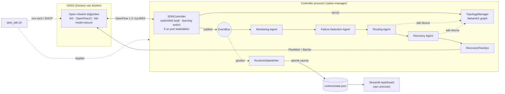
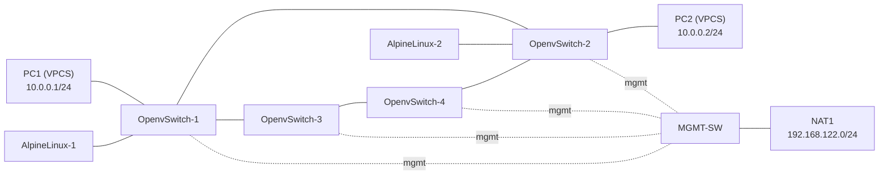
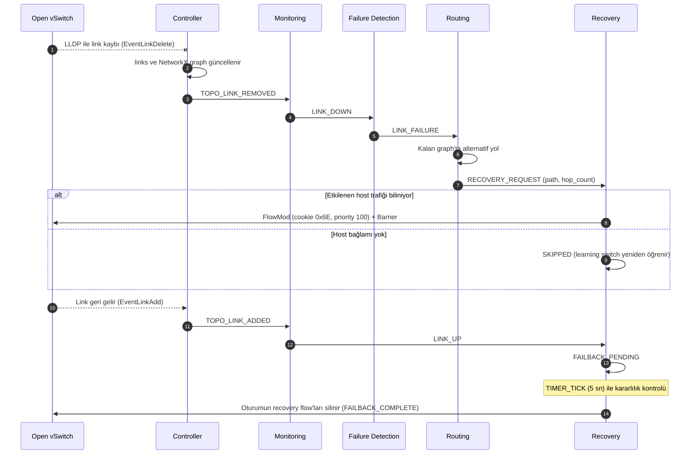
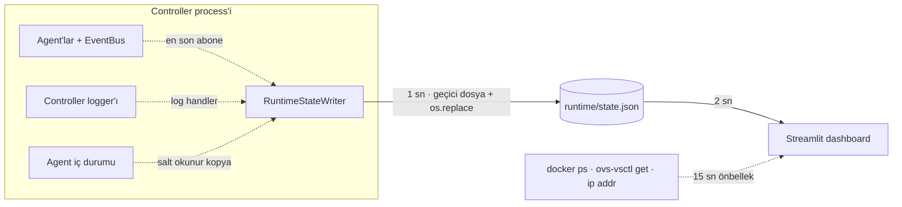

# Multi-Agent Tabanlı Akıllı Self-Healing SDN

## Proje Özeti

Bu proje, GNS3 üzerinde Docker tabanlı Open vSwitch düğümleriyle kurulan bir
ağda çalışan, **OpenFlow 1.3** ve **OS-Ken** controller tabanlı bir
Software-Defined Networking (SDN) sistemidir. Sistem topolojisini
**çalışma anında keşfeder** (switch'ler OpenFlow bağlantılarıyla, linkler
LLDP ile), keşfedilen topolojiyi bir **NetworkX** graph'ı olarak tutar ve
link arızalarına **olay güdümlü çok etmenli (event-driven multi-agent)** bir
yapıyla tepki verir.

Controller içinde dört agent çalışır: **Monitoring**, **Failure Detection**,
**Routing** ve **Recovery**. Bir switch-switch linki koptuğunda arıza
doğrulanır, güncel graph üzerinde alternatif yol hesaplanır ve — etkilenen
host trafiği biliniyorsa — bu yol OpenFlow FlowMod mesajlarıyla switch'lere
recovery flow'u olarak gönderilir; link geri geldiğinde kararlılık süresinin ardından **failback**
yapılır.

Projenin uzun vadeli hedefi, karar mekanizmasını toplanacak bir veri seti
üzerinde eğitilecek bir yapay zeka agent'ı ile geliştirmektir. **Mevcut
sistemde yapay zeka / makine öğrenmesi bileşeni yoktur**; tüm kararlar kural
tabanlıdır.

> **Durum özeti:** Resmi proje planındaki Aşama 0–6 tamamlanmıştır.
> **Aşama 7 (ölçümlü Multi-Agent Self-Healing testi) henüz başlamamıştır.**
> Aşama 6'nın ardından, resmi planın bir aşaması olmayan ek bir
> gözlem/otomasyon katmanı geliştirilmiştir: başlangıç otomasyonu
> (`start_sdn.sh`), runtime state çıktısı ve salt okunur izleme dashboard'u.
> AI Agent henüz sisteme eklenmemiştir.

---

## İçindekiler

1. [Mevcut Durum](#mevcut-durum)
2. [Mimari](#mimari)
3. [Agent Görevleri](#agent-görevleri)
4. [Dinamik Topoloji ve Routing](#dinamik-topoloji-ve-routing)
5. [Self-Healing Akışı](#self-healing-akışı)
6. [Startup Automation](#startup-automation)
7. [Dashboard](#dashboard)
8. [Testler](#testler)
9. [Live GNS3 Validation](#live-gns3-validation)
10. [Quick Start](#quick-start)
11. [Klasör Yapısı](#klasör-yapısı)
12. [Roadmap](#roadmap)
13. [Ölçüm Sınırları](#ölçüm-sınırları)

---

## Mevcut Durum

Aşağıdaki tablo yalnızca **kodda bulunan** ve **offline testlerle veya canlı
GNS3 kayıtlarıyla desteklenen** özellikleri içerir. "Kanıt" sütunundaki
canlı log kayıtları fonksiyonel gözlemdir; kontrollü deney veya ölçüm
sonucu değildir.

| Özellik | Kod | Kanıt |
|---|---|---|
| OS-Ken ile OpenFlow 1.3 bağlantısı, table-miss flow | `controller/sdn_controller.py` | Canlı: 4 OVS'te `is_connected=true`; table-miss (cookie `0x0`, priority 0) flow'ları switch'lerde mevcut |
| MAC-learning forwarding (spanning-tree tabanlı döngüsüz flood) | `controller/sdn_controller.py` | Canlı: learned flow'lar (cookie `0x5d`, priority 1) switch'lerde mevcut |
| Dinamik switch keşfi (DPID bazlı) | `controller/sdn_controller.py` | Canlı log: `SWITCH_ADDED`; 4 switch keşfedildi |
| LLDP tabanlı dinamik link keşfi | `controller/sdn_controller.py` (`os_ken.topology`) | Canlı log: `LINK_ADDED`; 4 link (halka topoloji) keşfedildi |
| NetworkX topoloji graph'ı, her değişiklikte senkronizasyon | `topology/topology_manager.py` | Canlı log: `TOPOLOGY_GRAPH`; offline testlerde gerçek `TopologyManager` kullanılır |
| Graph üzerinden shortest path hesabı | `topology/topology_manager.py` | Canlı log: `SHORTEST_PATH`; offline testlerde gerçek `TopologyManager` |
| Process-içi EventBus ve dört agent | `utils/event_bus.py`, `agents/` | Offline testler (zincir testleri) |
| Monitoring Agent: port durumu, throughput, packet rate, drop/error sayaçları | `agents/monitoring_agent.py` | Canlı log: `[MONITORING] METRIC`; offline: hız hesabı (`test_runtime_state_offline`) |
| Failure Detection Agent: HEALTHY / DEGRADED / FAILED | `agents/failure_agent.py` | Offline: 7 test |
| Routing Agent: arızalı/DEGRADED edge'leri dışlayan deterministik alternatif yol | `agents/routing_agent.py` | Offline: 11 test; canlı logda `ALTERNATIVE_PATH` kararları görülür |
| Recovery Agent: doğrulama, flow planı, OpenFlow recovery flow kurulumu, rollback | `agents/recovery_agent.py`, `RecoveryFlowOps` | Offline: 17 test (sahte flow tablosu ile); canlı logda bir olayda 16 recovery FlowMod'unun gönderildiği ve `PATH_ACTIVE` görülür (switch tablosunda doğrulanmadı) |
| Recovery yolu bozulunca oturumun geçersiz kılınması ve flow'ların silinmesi | `agents/recovery_agent.py` | Offline test (`test_recovery_path_link_down_invalidates`); canlı logda bir kez gözlendi |
| Kararlılık süresi sonrası otomatik failback | `agents/recovery_agent.py` | Kod ve offline testler (`test_h`, `test_i`, `test_j`, DEGRADED failback). **Canlı olarak doğrulanmadı** |
| Recovery güvenlik kontrolü (host bağlamı yoksa atlama) | `agents/recovery_agent.py` | Offline testler |
| Ek katman: dinamik GNS3 / OVS başlangıç otomasyonu | `start_sdn.sh` | Canlı: 4 OVS için management portları otomatik bulundu (`logs/mgmt_ports.cache`) |
| Ek katman: runtime state çıktısı ve salt okunur dashboard | `utils/runtime_state.py`, `dashboard/` | Offline: 6 test; canlı: controller `runtime/state.json` üretiyor |

---

## Mimari

### Yazılım mimarisi



- **Controller** (`controller/sdn_controller.py`): OpenFlow olaylarını
  işler, aktif switch (`datapaths`) ve link (`links`) kümelerini tutar,
  graph'ı günceller ve agent'lara olay yayınlar.
- **EventBus** (`utils/event_bus.py`): process-içi, senkron ve FIFO sıralı
  publish/subscribe. Agent'lar birbirini doğrudan çağırmaz. Bir subscriber
  hatası loglanır, diğerleri çalışmaya devam eder.
- **RecoveryFlowOps**: Recovery Agent'a verilen minimum OpenFlow yeteneği;
  yalnızca aktif switch'lere, yalnızca `in_port + eth_src + eth_dst`
  eşleşmeli flow kurar/siler ve cookie `0` ile işlemi reddeder.

### Deney topolojisi (GNS3 projesi `Smart_SDN_MultiAgent`)



Mevcut deney düzeneği 4 Open vSwitch'ten oluşan bir halka ve iki VPCS uç
cihazdan (PC1, PC2) oluşur; PC1/PC2 IP adresleri VPCS startup
configuration (`startup.vpc`) ile kalıcıdır. Management portları bir
Ethernet switch üzerinden GNS3 NAT düğümüne (libvirt `192.168.122.0/24`,
DHCP) bağlıdır ve controller'a bu ağ üzerinden erişilir.
**Bu yalnızca mevcut deney topolojisidir; kodda switch sayısı, DPID, port
numarası veya yol tanımı bulunmaz.**

---

## Agent Görevleri

| Agent | Abone olduğu olaylar | Yaptığı iş | Yayınladığı olaylar |
|---|---|---|---|
| **Monitoring** | `TOPO_LINK_ADDED`, `TOPO_LINK_REMOVED`, `PORT_STATUS_UPDATE`, `PORT_STATS_UPDATE`, `TOPO_SWITCH_REMOVED` | Link olaylarını izler; iki ardışık PortStats örneğinin farkından RX/TX Mbps, throughput, packet rate hesaplar; drop/error sayaçlarını ve port link/admin durumunu ekler. İlk örnek yalnızca baseline'dır. | `LINK_UP`, `LINK_DOWN`, `PORT_METRICS` |
| **Failure Detection** | `LINK_DOWN`, `LINK_UP`, `PORT_METRICS`, `TOPO_SWITCH_REMOVED` | `LINK_DOWN`'u anında `LINK_FAILURE` olarak onaylar. Port başına HEALTHY / DEGRADED / FAILED durumu tutar. | `LINK_FAILURE`, `PORT_HEALTH_CHANGED` |
| **Routing** | `LINK_FAILURE`, `PORT_HEALTH_CHANGED`, `TOPO_SWITCH_REMOVED` | Canlı graph üzerinde alternatif yol seçer (ayrıntı aşağıda). Yol yoksa yalnızca `NO_ALTERNATIVE_PATH` loglar. | `RECOVERY_REQUEST` |
| **Recovery** | `RECOVERY_REQUEST`, `LINK_FAILURE`, `LINK_UP`, `PORT_HEALTH_CHANGED`, `TOPO_LINK_ADDED`, `TOPO_SWITCH_REMOVED`, `HOST_SEEN`, `TIMER_TICK` | İsteği doğrular, etkilenen host çiftlerini bulur, flow'ları kurar, failback'i yönetir. | — (OpenFlow FlowMod) |

### Failure Detection durumları

| Durum | Koşul |
|---|---|
| `HEALTHY` | Port UP ve kalıcı anormallik yok |
| `DEGRADED` | Port UP, ancak **2 ardışık** örnekte drop oranı ≥ %5 veya error oranı ≥ %1 (aralıkta bir yönde en az 20 paket ve en az 5 kötü paket gerekir). 2 ardışık normal örnekle `HEALTHY`'ye döner. |
| `FAILED` | `LINK_DOWN` (`reason=link_down`) veya port link/admin DOWN (`reason=port_down`). `link_down` kaynaklı FAILED yalnızca `LINK_UP` ile temizlenir. |

Eşikler `agents/failure_agent.py` içinde sabit, laboratuvar için seçilmiş
kural tabanlı değerlerdir.

### Recovery Agent kuralları

| Kural | Uygulama |
|---|---|
| Wildcard flow yok | Her flow `in_port + eth_src + eth_dst` (iki bilinen unicast host MAC'i) eşler; çift yönlü, hedeften kaynağa doğru kurulur |
| Cookie / öncelik ayrımı | Recovery `0x6E` / priority 100; learned `0x5D` / priority 1; table-miss ve LLDP cookie `0`. Silmeler tam cookie maskesiyle yapılır |
| Host bağlamı | Host konumları controller'ın `HOST_SEEN` olayından (ISL olmayan portlardan) öğrenilir; yoksa `SKIPPED reason=insufficient_forwarding_context` |
| Kısmi kurulum | Bir flow gönderilemezse bu istekte kurulanlar geri alınır (`FLOW_INSTALL_FAILED`) |
| Tekrarlanan istek | Aynı link için aktif oturum varsa flow tekrar kurulmaz (`DUPLICATE_REQUEST`) |
| Graph | Canlı graph değiştirilmez; olay öncesi yol analizi için kopya kullanılır |

---

## Dinamik Topoloji ve Routing

**Topoloji gerçekten dinamik mi?** Evet. Kodda sabit switch listesi, DPID,
port veya `path1`/`path2` tanımı yoktur:

- **Switch keşfi:** `EventOFPSwitchFeatures` ve `EventOFPStateChange`
  (MAIN/DEAD) olaylarıyla `self.datapaths` sözlüğüne DPID bazlı eklenir/
  çıkarılır. Aynı DPID'nin yeniden bağlanması eski kaydın yerine geçer.
- **Link keşfi:** `osken-manager --observe-links` ile `os_ken.topology`
  LLDP gönderir; `EventLinkAdd` / `EventLinkDelete` olayları her fiziksel
  linki iki yönlü raporlar. Controller bunları yönsüz tek bir link kaydına
  indirger; link ancak iki yönü de kalktığında silinir.
- **Graph güncellemesi:** Her switch/link değişikliğinde
  `TopologyManager.sync(datapaths, links)` graph'ı controller verisine
  eşitler. Link silindiğinde agent zinciri graph güncellendikten **sonra**
  tetiklenir.
- **Döngüsüz flood:** Aynı link kümesinden deterministik bir spanning tree
  (Kruskal) hesaplanır; tree dışındaki switch-switch portlarından flood
  yapılmaz. Tree değişince learned flow'lar (cookie `0x5D`) temizlenir.

**Routing Agent nasıl yol seçiyor?**

1. Tetikleyici edge (arızalı veya DEGRADED link) hariç tutulur. DEGRADED
   link graph'ta fiziksel olarak kalır; yalnızca bu hesap için gizlenir.
2. Önce bilinen diğer DEGRADED edge'ler de hariç tutulur; bu durumda yol
   yoksa yalnızca tetikleyici edge hariç tutularak tekrar denenir.
3. Hariç tutma `networkx.restricted_view` ile salt okunur bir görünümde
   yapılır; canlı graph değişmez.
4. En az hop'lu yollar arasından DPID listesi sözlük sırasına göre en küçük
   olan seçilir (deterministik).
5. DEGRADED port bir host portuysa (switch-switch linki değilse) yol
   hesaplanmaz (`DEGRADED_HOST_PORT ignored`).

---

## Self-Healing Akışı



**Failback nasıl uygulanıyor?** (Kodda uygulanmış ve offline testlerle
doğrulanmıştır; canlı ortamda tamamlanmış bir failback kaydı henüz yoktur.)

- `LINK_FAILURE` oturumunda link `LINK_UP` ile geri geldiğinde, `PORT_DEGRADED`
  oturumunda ise port `DEGRADED → HEALTHY` olduğunda oturum
  `FAILBACK_PENDING` olur.
- Ayrı bir thread yoktur; controller'ın 5 sn'lik istatistik döngüsündeki
  `TIMER_TICK` kullanılır. `FAILBACK_STABLE_SECONDS = 10` olduğundan fiili
  bekleme 10–15 sn'dir.
- Süre dolduğunda link graph'ta aynı portlarla duruyorsa ve hostlar arasında
  normal yol varsa, yalnızca o oturumun recovery flow'ları ve ilgili MAC
  çiftinin learned flow'ları silinir; normal learning forwarding devralır.
- Bekleme sırasında link tekrar düşerse veya port tekrar DEGRADED olursa
  failback iptal edilir (`FAILBACK_CANCELLED`).

---

## Startup Automation

`start_sdn.sh`, GNS3 her açıldığında elle yapılan Open vSwitch management
ayarlarını otomatikleştirir. Aşama 6 sonrasında eklenen bir yardımcı
otomasyondur; resmi proje planında ayrı bir aşama değildir.

| Adım | Davranış |
|---|---|
| OVS keşfi | `docker ps` çıktısında `^GNS3\.OpenvSwitch-` ile başlayan tüm container'lar bulunur ve doğal sıralanır; switch sayısı önceden bilinmez |
| Management port tespiti | Önce bridge dışında olan, `192.168.122.x` IP'li ve `192.168.122.1`'e ping atabilen port aranır (tekrar çalıştırmada tarama yapılmaz). Yoksa adaylar sırayla denenir: önceki çalıştırmadan kalan ipucu (`logs/mgmt_ports.cache`), bridge dışı portlar, sonra bridge'deki portlar |
| Aday testi | Port bridge'den geçici ayrılır, UP yapılır, `udhcpc` ile kısa DHCP denenir; IP `192.168.122.0/24`'ten gelir **ve** `192.168.122.1`'e ping atılabilirse kabul edilir |
| Geri alma | Başarısız adayın IP'si temizlenir, `/etc/resolv.conf` geri yüklenir ve port **aynı `ofport` numarasıyla** eski bridge'ine geri eklenir; Ctrl-C'de de aynı geri alma çalışır |
| br0 ayarları | Controller `tcp:192.168.122.1:6653`, `protocols=OpenFlow13`, `fail-mode=secure` yalnızca farklıysa değiştirilir |
| Controller | `osken-manager --observe-links controller/sdn_controller.py` zaten çalışıyorsa başlatılmaz; birden fazla süreç varsa listelenir, hiçbiri kapatılmaz. Log: `logs/controller.log` |
| Özet | Her switch için management portu, IP, controller bağlantısı ve durum tablo halinde yazdırılır |

Aynı anda iki kopyanın çalışması `flock` ile engellenir. Yeni bir
`OpenvSwitch-N` düğümü eklendiğinde kod değişikliği gerekmez. Sınırlamalar:
keşif GNS3 container **adına** (`GNS3.OpenvSwitch-*`) dayanır; management
ağı (`192.168.122.0/24`), controller adresi ve bridge adı (`br0`) script
içinde yapılandırma sabitleridir.

---

## Dashboard

Streamlit tabanlı, salt okunur bir izleme arayüzü. Controller'a, agent'lara
veya OVS ayarlarına **yazmaz**. Dashboard, Aşama 6 sonrasında eklenen bir
**ek gözlem katmanıdır**; resmi plandaki Aşama 7'nin (ölçümlü test) parçası
değildir ve şu ana kadar bir ölçüm aracı olarak kullanılmamıştır.

### Runtime state nasıl üretiliyor?



- `RuntimeStateWriter` (`utils/runtime_state.py`) controller içinde bir hub
  thread'inde çalışır; EventBus'a agent'lardan sonra abone olur, agent iç
  durumlarını (port sağlığı, DEGRADED linkler, recovery oturumları, host
  konumları) yalnızca okur ve agent log satırlarını olay günlüğü için yakalar.
- State, aynı dizinde geçici dosyaya yazılıp `os.replace` ile atomik olarak
  değiştirilir. Dashboard ayrı bir process'tir ve yalnızca bu dosyayı okur;
  okuma hatasında son geçerli durumu kullanır.
- Controller durumu: state dosyası 6 sn'den yeni ve yazan PID yaşıyorsa
  `ONLINE`, PID yaşıyor ama veri eskiyse `STALE`, aksi halde `OFFLINE`.

### Gösterilen veriler

| Bölüm | İçerik | Veri kaynağı |
|---|---|---|
| Durum kartları | Controller durumu, switch sayısı, aktif link sayısı, aktif failure (FAILED + DEGRADED link), recovery durumu | `state.json`, `/proc` |
| Canlı topoloji | Switch'ler ve linkler; FAILED, DEGRADED, aktif recovery yolu ve son routing kararı ayrı biçimde | Controller graph'ı ve link kümeleri |
| Agent kartları | Her agent için durum, sayaçlar, son olay ve zamanı | Agent iç durumu, log olayları |
| Self-healing | Son failure, etkilenen link, nedeni, olay zaman çizelgesi, seçilen path ve hop count, recovery oturumları ve flow sayıları, failback durumu, incident geçmişi | Log olayları, `RECOVERY_REQUEST`, Recovery Agent oturumları |
| Monitoring | Switch/port filtreli tablo: link durumu, sağlık, RX/TX Mbps, throughput, packet rate, drop/error (aralık ve toplam), son ~5 dk grafiği | `PORT_METRICS` |
| Open vSwitch tablosu | Ad, DPID, management interface/IP, OpenFlow bağlantısı, OVS `is_connected`, port sayısı | Controller + Docker (salt okunur) |
| Olay günlüğü | Monitoring / Failure / Routing / Recovery / Controller olayları, kaynak/seviye/metin filtresi. Port başına 5 sn'lik `METRIC` satırları gösterilmez | Controller logger'ı |

Switch adları Docker envanterinden okunur; Docker'a erişilemezse DPID'den
türetilir.

---

## Testler

Offline testler GNS3 veya OS-Ken bağlantısı gerektirmez. Gerçek agent
sınıfları, gerçek `EventBus` ve gerçek `TopologyManager` kullanılır; switch
flow tabloları sahte bir model (`FakeFlowOps`) ile temsil edilir. DPID ve
port numaraları keyfi seçilmiştir.

**Toplam: 41 offline test — tamamı başarılı.**

| Dosya | Test | Doğrulanan davranışlar |
|---|---:|---|
| `tests/test_failure_agent_offline.py` | 7 | DEGRADED'a geçiş ve dönüş, tekil spike'ların DEGRADED üretmemesi, error eşiği, büyük sayaç / boşta port, port down → FAILED → geri dönüş, `LINK_DOWN → LINK_FAILURE` zinciri ve `LINK_UP` ile temizlenme, switch silinince temizlik |
| `tests/test_routing_agent_offline.py` | 11 | Link failure sonrası alternatif yol, yol yokluğu, DEGRADED switch-switch linki, iki uçtan DEGRADED, host portunun yok sayılması, tekrarlanan DEGRADED, DEGRADED → HEALTHY, diğer DEGRADED linklerden kaçınma ve geri düşme, eşit maliyette deterministik seçim, keyfi DPID'ler, switch silinmesi |
| `tests/test_recovery_agent_offline.py` | 17 | Geçerli alternatif yol ve flow listesi, keyfi DPID/port, yetersiz host bağlamı, ISL portunda host öğrenilmemesi, yol yokluğu, cookie/priority izolasyonu, DEGRADED isteği, tekrarlanan istek, `LINK_UP` → pending, kararlı failback, failback iptali, switch kaybı, kısmi kurulumda rollback, DEGRADED failback ve FAILED'a yükselme, recovery yolunun düşmesi, canlı graph'ın değişmemesi |
| `tests/test_runtime_state_offline.py` | 6 | Writer eklenince agent davranışının (istekler, flow tablosu, log satırları) değişmemesi, failure → routing → recovery → failback zincirinin state'e yansıması, SKIPPED nedeni, Monitoring hız hesabı ve metrik geçmişi, atomik yazma, dashboard okuyucusunun eksik/bozuk dosyaya dayanıklılığı |

Kapsam notları: Monitoring Agent'ın ayrı bir test dosyası yoktur; zincir
testleri ve `test_runtime_state_offline` içinde çalıştırılır. Controller
(`sdn_controller.py`), `start_sdn.sh` ve dashboard arayüzü (`app.py`) için
otomatik test yoktur.

Çalıştırma (proje kökünden):

```bash
python3 -m unittest -v \
    tests.test_failure_agent_offline \
    tests.test_routing_agent_offline \
    tests.test_recovery_agent_offline \
    tests.test_runtime_state_offline

# veya
python3 -m unittest discover -s tests -p 'test_*_offline.py'
```

---

## Live GNS3 Validation

Bu bölüm yalnızca **mevcut kayıtlarla** (controller logu `logs/controller.log`,
`runtime/state.json`, switch flow tabloları ve `logs/mgmt_ports.cache`)
doğrulanabilen gözlemleri içerir. Bunlar fonksiyonel gözlemlerdir; kontrollü
deney veya nicel ölçüm değildir.

| # | Gözlem | Kayıt |
|---|---|---|
| 1 | 4 Open vSwitch controller'a OpenFlow 1.3 ile bağlandı ve DPID'leriyle keşfedildi | `SWITCH_ADDED` (4 farklı DPID), OVS `is_connected=true` |
| 2 | Halka topolojisinin 4 switch-switch linki LLDP ile keşfedildi | `LINK_ADDED`, `state.json` |
| 3 | Switch'lerde table-miss, LLDP ve learned (cookie `0x5d`) flow'ları kurulu | `ovs-ofctl -O OpenFlow13 dump-flows br0` |
| 4 | `start_sdn.sh` 4 OVS'in management portlarını otomatik buldu (OVS-1/2: `eth3`, OVS-3/4: `eth1`) | `logs/mgmt_ports.cache`, GNS3 proje dosyasıyla tutarlı |
| 5 | Controller canlı `runtime/state.json` üretiyor (4 switch, 4 link) | `runtime/state.json` |
| 6 | PC1–PC2 trafiğinin kullandığı OVS-1–OVS-2 linkinin kaybından sonra agent zinciri çalıştı: Routing Agent 3 hop'luk alternatif yolu seçti, Recovery Agent bilinen iki host çifti için 4 switch'e 16 recovery FlowMod'u gönderdi (`FLOW_INSTALLED`, gönderim başarılı) ve 2 yolu `PATH_ACTIVE` olarak işaretledi. Switch flow tabloları bu anda okunmadığından flow'ların switch tarafında varlığı ayrıca doğrulanmamıştır | `ALTERNATIVE_PATH`, `FLOW_INSTALL_START pairs=2 flows=16`, 16 × `FLOW_INSTALLED`, 2 × `PATH_ACTIVE` |
| 7 | Hemen ardından recovery yolu üzerindeki bir link de düştüğünde oturum geçersiz sayıldı ve oturumun 16 recovery flow'u için silme mesajı gönderildi. Aynı dönemde switch yeniden bağlantıları da kayıtlı olduğundan bu link kaybının nedeni loglardan ayırt edilemez | `SESSION_INVALIDATED reason=recovery_path_link_down`, `RECOVERY_FLOWS_REMOVED removed=16/16` |

Kayıtlar yerel `logs/controller.log` dosyasındadır (12 Ekim 2026 controller
oturumu); `logs/` dizini Git'e eklenmez.

**Deney sonucu olarak sunulmayan kayıtlar.** Aynı log; controller yeniden
başlatmaları, startup otomasyonu ve switch yeniden bağlantıları sırasında
oluşan çok sayıda `SWITCH_REMOVED`, `LINK_REMOVED`, `LINK_FAILURE`,
`NO_ALTERNATIVE_PATH` ve `SKIPPED` kaydı da içerir. Bu kayıtların hangisinin
kasıtlı bir link testine, hangisinin yeniden bağlantıya ait olduğu loglardan
ayırt edilemediği için sayıları ve sonuçları burada deney sonucu olarak
verilmemiştir.

**Henüz kayıt altında olmayan canlı adımlar.** Aşağıdakilerin mevcut canlı
kayıtlarda karşılığı yoktur:

- Recovery flow'larının switch flow tablosunda (`cookie=0x6e`) okunarak
  doğrulanması (log kaydı FlowMod'un gönderildiğini gösterir; switch
  tarafındaki tablo bu oturumda kaydedilmemiştir),
- recovery sırasında PC1–PC2 trafiğinin (ör. ping) kesintisiz devam ettiğinin
  ölçülmesi,
- link geri geldikten sonra `FAILBACK_PENDING → FAILBACK_COMPLETE`
  akışının canlı olarak tamamlanması (failback yalnızca kod ve offline
  testlerle doğrulanmıştır).

Bu adımlar **Aşama 7'de kayıt altına alınarak ve ölçülerek
tekrarlanacaktır**.

---

## Quick Start

### Gereksinimler

| Bileşen | Kurulum |
|---|---|
| GNS3 + Docker, `gns3/openvswitch` image | GNS3 ortamı |
| OS-Ken, NetworkX (controller) | `sudo apt install python3-os-ken python3-networkx` |
| Dashboard bağımlılıkları | `python3 -m venv .venv && .venv/bin/pip install -r dashboard/requirements.txt` |

Controller sistem Python'u ile, dashboard proje içindeki `.venv` ile çalışır.

### Çalıştırma

```bash
cd ~/smart-sdn-gns3

# 1) GNS3 projesini açıp düğümleri başlattıktan sonra
./start_sdn.sh                    # OVS ayarları + controller
./start_sdn.sh --no-controller    # yalnızca OVS ayarları

# 2) Dashboard
./start_dashboard.sh              # http://localhost:8501

# 3) Controller logu
tail -f logs/controller.log
```

Controller'ı elle başlatmak için (`--observe-links` link keşfi için
zorunludur):

```bash
osken-manager --observe-links controller/sdn_controller.py
```

---

## Klasör Yapısı

```text
smart-sdn-gns3/
├── agents/
│   ├── __init__.py
│   ├── monitoring_agent.py     # port metrikleri, link olayları
│   ├── failure_agent.py        # HEALTHY / DEGRADED / FAILED
│   ├── routing_agent.py        # alternatif yol kararı
│   └── recovery_agent.py       # OpenFlow recovery flow'ları + failback
├── controller/
│   └── sdn_controller.py       # OS-Ken uygulaması, keşif, learning switch, RecoveryFlowOps
├── dashboard/
│   ├── app.py                  # Streamlit arayüzü
│   ├── state_reader.py         # state.json, /proc ve Docker okuyucu
│   └── requirements.txt
├── topology/
│   ├── __init__.py
│   └── topology_manager.py     # NetworkX graph, shortest path
├── utils/
│   ├── __init__.py
│   ├── event_bus.py            # EventBus ve olay adları
│   └── runtime_state.py        # RuntimeStateWriter
├── tests/
│   ├── test_failure_agent_offline.py
│   ├── test_routing_agent_offline.py
│   ├── test_recovery_agent_offline.py
│   └── test_runtime_state_offline.py
├── .streamlit/config.toml      # dashboard teması
├── start_sdn.sh                # GNS3/OVS başlangıç otomasyonu
├── start_dashboard.sh          # dashboard başlatıcı
└── .gitignore
```

Çalışma sırasında oluşan `logs/`, `runtime/` ve `.venv/` dizinleri
`.gitignore` ile Git dışında tutulur. `datasets/` dizini Aşama 8 için
ayrılmıştır ve şu an boştur.

---

## Roadmap

Resmi proje planı ve mevcut durum:

| Aşama | Kapsam | Durum | Dayanak |
|---|---|---|---|
| 0 | Mevcut Mininet sürümünü referans olarak koruma | Tamamlandı | Ayrı yerel depo (`~/sdn-ai-project`: Mininet, iki yollu statik topoloji); bu repoya dahil değildir |
| 1 | GNS3 ortamını hazırlama | Tamamlandı | GNS3 projesi ve Docker tabanlı OVS düğümleri (repo dışı) |
| 2 | GNS3 üzerinde ilk SDN topolojisi | Tamamlandı | GNS3 projesi `Smart_SDN_MultiAgent`: 4 OVS halka, PC1–PC2 |
| 3 | OS-Ken ve OpenFlow bağlantısı | Tamamlandı | `sdn_controller.py` (ilk commit `6e2dd2c`), canlı OpenFlow bağlantısı |
| 4 | Dinamik topoloji keşfi | Tamamlandı | Switch keşfi, LLDP link keşfi, NetworkX graph (`6e2dd2c`) |
| 5 | Dinamik yol hesaplama | Tamamlandı | `TopologyManager.get_shortest_path` (`6e2dd2c`), Routing Agent |
| 6 | Multi-Agent mimari | Tamamlandı (kod + offline test; canlı doğrulama kısmi) | 6.1 iskelet `49cf9e6` · 6.2 Monitoring `88850fd`, `d03e7da` · 6.3 Failure Detection `88f72fe` · 6.4 Routing `c889df1` · 6.5 Recovery/failback `7650bb4` |
| Ek | Aşama 6 sonrası ek gözlem/otomasyon katmanı (resmi plan dışı): startup otomasyonu, runtime state, dashboard | Tamamlandı | `5fb02bb`, `7022b67` |
| 7 | Ölçümlü Multi-Agent Self-Healing testi | **Sıradaki aşama — henüz başlamadı** | — |
| 8 | Dataset oluşturma | Planlanıyor | — |
| 9 | AI Agent | Planlanıyor | — |
| 10 | Agent haberleşmesini güçlendirme | Planlanıyor | — |
| 11 | Deneyler ve karşılaştırma | Planlanıyor | — |

Commit geçmişine göre gelişim sırası: dinamik topoloji ve shortest path
(Aşama 3–5) → multi-agent iskeleti (6.1) → Monitoring metrikleri ve
forwarding düzeltmesi (6.2) → Failure Detection sağlık durumları (6.3) →
Routing karar motoru (6.4) → Recovery ve failback (6.5) → depo güvenlik
ayarları → startup otomasyonu → izleme dashboard'u.

---

## Ölçüm Sınırları

- **Drop / loss:** Dashboard'daki drop/loss bilgisi OpenFlow port
  sayaçlarına (`rx_dropped`, `tx_dropped`, `rx_errors`, `tx_errors`)
  dayanır. Uçtan uca packet loss ve latency sistemde ölçülmemektedir; Aşama 7
  deneylerinde ayrıca ölçülecektir.
- **Recovery süresi:** Dashboard'da gösterilen süre, controller'ın
  `LINK_DOWN` olayını işlemesinden recovery yolunun aktif olmasına kadar
  geçen **controller içi** süredir. LLDP tabanlı arıza algılama gecikmesi ve
  veri düzleminde trafiğin gerçekten yeni yola geçme süresi bu değere dahil
  değildir.
- **Nicel sonuç yok:** Bu README'de recovery süresi, paket kaybı veya
  throughput için ölçülmüş bir değer verilmemiştir; sistematik ölçümler
  Aşama 7'nin konusudur.
- **Eşikler:** Failure Detection eşikleri laboratuvar için seçilmiş geçici
  değerlerdir; genellenebilirlikleri değerlendirilmemiştir.
- **Recovery kapsamı:** Recovery flow'ları yalnızca controller'ın gördüğü
  host konumları için kurulur; host trafiği görülmeden oluşan arızalarda
  recovery bilinçli olarak atlanır ve forwarding learning switch'e bırakılır.
- **Metrik çözünürlüğü:** Port istatistikleri 5 sn aralıkla toplanır; daha
  kısa süreli olaylar ortalamaya karışır.
