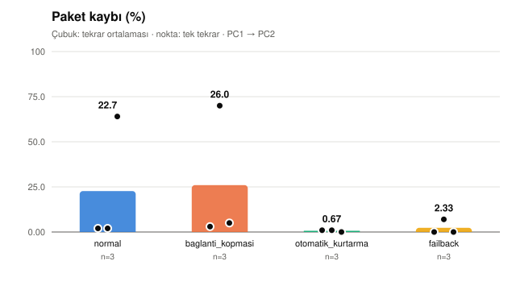
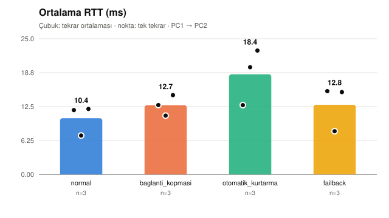
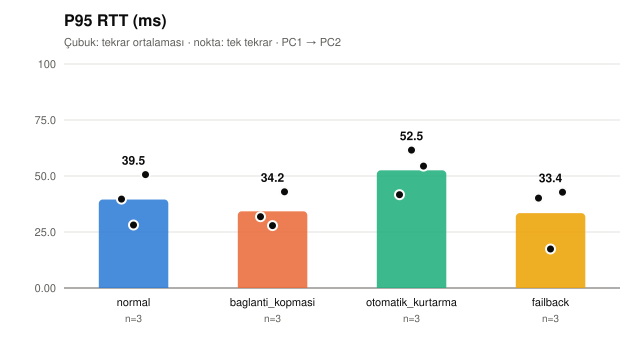
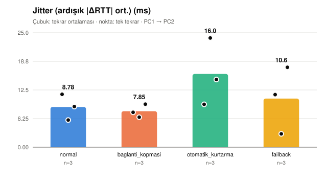
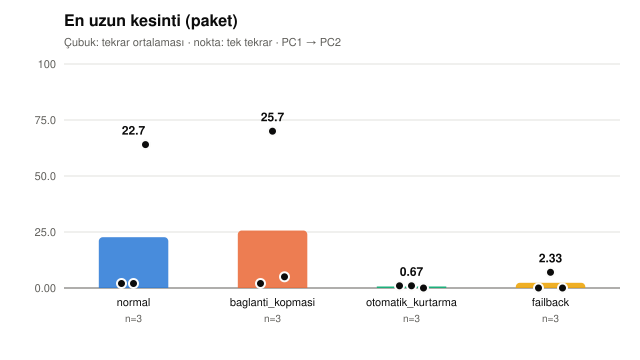

# Aşama 8 – Self-Healing Performans Deneyleri Sonuç Raporu

**Proje:** Smart SDN Multi-Agent Self-Healing Network
**Deney dönemi:** 21 Kasım 2026 – 22 Kasım 2026 (ping kayıtlarındaki `tarih` başlıkları ve dosya zamanları)
**Ölçüm hattı:** PC1 (`10.0.0.1`) → PC2 (`10.0.0.2`), her deneyde 100 ICMP echo
**Veri kaynakları:** [`sonuclar/deney_sonuclari.csv`](sonuclar/deney_sonuclari.csv), [`sonuclar/senaryo_ozeti.csv`](sonuclar/senaryo_ozeti.csv), [`ham_veri/`](ham_veri/), [`kaynak_kopyalar/`](kaynak_kopyalar/), `logs/controller.log` ve `runtime/state.json`

> **Okuma notu.** Bu rapor yalnızca depodaki gerçek kayıtlara dayanır. Kayıtlardan doğrulanamayan her bilgi "doğrulanamadı", "çıkarım" veya "kullanıcı gözlemi" olarak işaretlenmiştir. Rapor, sistemin başarısını değil, **ölçülen davranışını** belgelemeyi amaçlar. Sonuçlar karışıktır: 12 deneyin 6'sı analiz programı tarafından `BASARILI`, 6'sı `BASARISIZ` olarak değerlendirilmiştir.

---

## İçindekiler

1. [Giriş ve deneylerin amacı](#1-giriş-ve-deneylerin-amacı)
2. [Deney ortamı ve kullanılan teknolojiler](#2-deney-ortamı-ve-kullanılan-teknolojiler)
3. [Deney metodolojisi](#3-deney-metodolojisi)
4. [Ölçülen performans metrikleri](#4-ölçülen-performans-metrikleri)
5. [Dört deney senaryosu](#5-dört-deney-senaryosu)
6. [Her senaryonun üç tekrarlı sonuçları](#6-her-senaryonun-üç-tekrarlı-sonuçları)
7. [Senaryoların karşılaştırmalı analizi](#7-senaryoların-karşılaştırmalı-analizi)
8. [Paket kaybı grafiği](#8-paket-kaybı-grafiğinin-yorumlanması)
9. [Ortalama RTT grafiği](#9-ortalama-rtt-grafiğinin-yorumlanması)
10. [P95 RTT grafiği](#10-p95-rtt-grafiğinin-yorumlanması)
11. [Jitter grafiği](#11-jitter-grafiğinin-yorumlanması)
12. [En uzun paket kaybı grafiği](#12-en-uzun-paket-kaybı-grafiğinin-yorumlanması)
13. [Recovery Agent performansı](#13-recovery-agent-performansının-değerlendirilmesi)
14. [Failover ve failback davranışı](#14-failover-ve-failback-davranışlarının-değerlendirilmesi)
15. [Gözlemlenen sistem sorunları](#15-gözlemlenen-sistem-sorunları)
16. [Deneylerin sınırlamaları](#16-deneylerin-sınırlamaları)
17. [Genel sonuç ve gelecek çalışmalar](#17-genel-sonuç-ve-gelecek-çalışmalar)

---

## 1. Giriş ve deneylerin amacı

Smart SDN, GNS3 üzerinde dört Open vSwitch (OVS) ve OS-Ken Controller ile kurulan, dört ajanlı (Monitoring, Failure Detection, Routing, Recovery) kural tabanlı bir self-healing SDN sistemidir. Aşama 7'de arıza tespiti, alternatif yol hesabı, OpenFlow ile kurtarma ve failback işlevleri canlı olarak gösterilmiş; ancak ölçüm yalnızca Controller içi olay süreleriyle sınırlı kalmıştır.

Aşama 8'in amacı, bu davranışı **kullanıcının yaşadığı iletişim** açısından, yani PC1 → PC2 ping'i üzerinden, tekrarlı ve kayıt altına alınmış biçimde ölçmektir. Dört soru yanıtlanmaya çalışılmıştır:

1. Normal ağda ping kaybı ve gecikmesi nedir (taban çizgisi)?
2. Bir omurga bağlantısı kesildiğinde kullanıcı ne kadar paket kaybeder ve iletişim yeniden kurulur mu?
3. Bağlantı kopukken sistem alternatif yolda kayıpsız iletişim sağlayabiliyor mu?
4. Bağlantı geri geldiğinde (failback) iletişim kesintiye uğruyor mu?

Bu rapor 12 gerçek deneyin (4 senaryo × 3 tekrar) sonuçlarını sunar. Aşama 8.1–8.4'te yapılan ön denemeler ([`ASAMA_8_DENEY_SONUCLARI.md`](ASAMA_8_DENEY_SONUCLARI.md)) bu 12 deneyin parçası değildir; ham ping çıktıları saklanmadığı için istatistiksel analize dahil edilmemiştir.

## 2. Deney ortamı ve kullanılan teknolojiler

| Bileşen | Ayrıntı |
|:--|:--|
| Simülasyon | GNS3 2.2.x, VirtualBox üzerinde Ubuntu 22.04 (README'deki ortam tanımı) |
| SDN anahtarları | 4 × Open vSwitch (Docker düğümü), OpenFlow 1.3 |
| Controller | OS-Ken, `osken-manager --observe-links` ile LLDP tabanlı link keşfi; Controller kodu [`controller/sdn_controller.py`](../controller/sdn_controller.py) |
| Ajanlar | [`agents/`](../agents/) altında Monitoring, Failure, Routing, Recovery; `utils/event_bus.py` ile haberleşme |
| Topoloji | NetworkX grafı ([`topology/topology_manager.py`](../topology/topology_manager.py)); sağlıklı durumda 4 düğüm, 4 kenar |
| Test uçları | VPCS `PC1` (`10.0.0.1`) ve `PC2` (`10.0.0.2`) |
| Arıza enjeksiyonu | GNS3 arayüzünde OpenvSwitch-1 ↔ OpenvSwitch-2 bağlantısına **Suspend / Resume** (state kayıtlarında `0000a6e4b3448f46:17 <-> 0000ee18eefc3841:4` bağlantısı) |
| Durum kaydı | `runtime/state.json` (son 200 olay, son 20 olay-incident) → deney sonrası `ham_veri/*_state.json` kopyaları |
| Analiz | Python 3 standart kütüphanesi: [`ping_analyzer.py`](ping_analyzer.py), [`experiment_runner.py`](experiment_runner.py) |

Sağlıklı omurga halkadır: OVS-1–OVS-2, OVS-1–OVS-3, OVS-3–OVS-4, OVS-4–OVS-2. OVS-1 ↔ OVS-2 bağlantısı kesildiğinde örnek alternatif yol `OVS-1 → OVS-3 → OVS-4 → OVS-2`'dir (state kayıtlarındaki `route.path` 4 düğümlü, 3 sıçramalı yoldur).

## 3. Deney metodolojisi

- **Veri toplama (Yöntem A):** Ping, GNS3 konsolundan elle başlatıldı; VPCS çıktısı [`ham_veri/`](ham_veri/) içindeki şablon dosyalarına yapıştırıldı. VPCS konsoluna otomatik bağlanılmadı (konsol tek istemci kabul ediyor ve bu istemci GNS3 Server; ayrıntı için [`README.md`](README.md)). Pcap yöntemi (Yöntem B) **kullanılmadı**; dolayısıyla hiçbir deneyde zaman damgalı paket verisi yoktur.
- **Tekrar:** Her senaryo için 3 tekrar (`_t1`, `_t2`, `_t3`). Her deneyde `ping 10.0.0.2 -c 100`, nominal aralık 1 s.
- **Controller kanıtı:** Her deneyden sonra `runtime/state.json` kopyalandı (`*_state.json`). Normal ağ deneylerinde state kopyası alınmamıştır.
- **Analiz:** `experiment_runner.py analiz` komutu tüm kayıtları işleyip CSV ve SVG üretir. Yalnızca `veri_turu=GERCEK_OLCUM` kayıtlar özete girer; 12 kaydın tamamı bu türdedir.
- **Durum kodları:** Analiz programı her deneyi `BASARILI`, `BASARISIZ` veya `BELIRSIZ` olarak sınıflandırır (bkz. [Bölüm 6.5](#65-analiz-programının-değerlendirme-ölçütleri)). 12 deneyin hiçbiri `BELIRSIZ` değildir; eksik `icmp_seq` yoktur.
- **Tarihler:** Dosya başlığındaki `tarih` alanı şablonun oluşturulma zamanıdır; ping'in tam başlangıç/bitiş zamanı kayıtlı değildir. `baglanti_kopmasi_t3` şablonu 21 Kasım 23:09'da oluşturulmuş, ancak ilgili state kopyası (14:46:42) ve ham dosya 22 Kasım'a aittir; yani şablon bir gün önce hazırlanıp ertesi gün kullanılmıştır.
- **`olay_ping` alanı:** Suspend/Resume anındaki `icmp_seq` başlığı 12 dosyanın hiçbirinde doldurulmamıştır. Bu nedenle `oncesi_*`/`sonrasi_*` karşılaştırmaları yalnızca en uzun kayıp patlaması bölme noktası olarak üretilmiştir ve failback deneylerinde Resume anı kayıtlı değildir.

## 4. Ölçülen performans metrikleri

| Metrik | Tanım (özet) | Not |
|:--|:--|:--|
| Paket kaybı (%) | `kayip_paket / gönderilen × 100` | Yalnızca açık `timeout` kayıp sayılır |
| Ortalama / medyan RTT | Yanıtlanan paketlerin RTT'si | Birkaç büyük sıçrama ortalamayı yukarı çeker |
| P95 RTT | En yakın sıra (nearest-rank) yöntemi | n≈100 olduğundan uç değerlere duyarlı |
| Jitter | Ardışık yanıtlanan paketlerin `|ΔRTT|` ortalaması | RFC 3550 üstel yumuşatma uygulanmaz |
| En uzun kayıp patlaması | Art arda kaybolan en uzun paket dizisi | Kullanıcının yaşadığı kesintinin **paket cinsinden** ölçüsü |
| Nominal kesinti (s) | Patlama × 1 s aralık | **Tahmindir**; VPCS timeout süresi aralığı etkileyebilir |
| Controller tespit→PATH_ACTIVE (ms) | `state.json` incident adımları | Controller **içi** süre |

**Kritik ayrım.** Controller'ın `DETECTED → PATH_ACTIVE` süresi (milisaniye mertebesinde) ile PC1'in yaşadığı paket kaybı süresi (saniye mertebesinde) **farklı büyüklüklerdir ve farklı olaylardır**. İlki Controller `LINK_DOWN` olayını gördükten sonraki iç işlem süresidir; fiziksel kopmadan Controller'ın olayı görmesine kadar geçen süreyi, anahtarlardaki akış güncellemesinin etkisini ve istemci tarafındaki ARP/timeout davranışını içermez. İkincisi kullanıcının uçtan uca deneyimidir. Bu raporda ikisi hiçbir yerde birbirine eşitlenmemiş veya birinden diğeri türetilmemiştir.

## 5. Dört deney senaryosu

| # | Senaryo | Uygulama | Başarı ölçütü (analiz programı) |
|:--:|:--|:--|:--|
| 1 | **Normal ağ** (`normal`) | Topoloji sağlıklıyken 100 ping | Kayıp = 0 |
| 2 | **Bağlantı kopması** (`baglanti_kopmasi`) | Ping sırasında (~30. paket) OVS-1 ↔ OVS-2 bağlantısı Suspend edilir ve kopuk bırakılır | Son paket yanıtlanmış olmalı (iletişim yeniden kurulmalı) |
| 3 | **Otomatik kurtarma** (`otomatik_kurtarma`) | Bağlantı zaten kopukken ve kurtarma yolu etkinken 100 ping | Kayıp = 0 |
| 4 | **Failback** (`failback`) | Ping sırasında (~30. paket) bağlantı Resume edilir; ≥15 s ping sürmeli | Son paket yanıtlanmış olmalı |

## 6. Her senaryonun üç tekrarlı sonuçları

Tüm değerler `deney_sonuclari.csv` dosyasından alınmıştır. Her deneyde gönderilen paket sayısı 100'dür. RTT değerleri ms'dir.

### 6.1 Normal ağ

| Tekrar | Durum | Yanıt / Kayıp | Kayıp % | Kayıp seq | Ort RTT | Medyan | P95 | Maks | Jitter |
|:--:|:--:|:--:|--:|:--|--:|--:|--:|--:|--:|
| t1 | BASARISIZ | 98 / 2 | 2,0 | 66–67 | 11,850 | 5,532 | 39,701 | 200,556 | 11,547 |
| t2 | BASARISIZ | 98 / 2 | 2,0 | 41–42 | 7,164 | 4,023 | 28,118 | 112,762 | 5,925 |
| t3 | BASARISIZ | 36 / 64 | **64,0** | 37–100 | 12,061 | 5,008 | 50,643 | 124,853 | 8,871 |

`normal_t3`'te 37. paketten itibaren 64 paketin tamamı timeout olmuş ve kayıt kayıpla bitmiştir; iletişim ölçüm bitene kadar yeniden kurulmamıştır. Bu bir **arıza enjeksiyonu içermeyen** deneydir, yani sistem hiçbir bağlantı kesilmeden iletişimini yitirmiştir. Üç normal deneyin hiçbirinde state kopyası yoktur; bu nedenle nedeni Controller kayıtlarıyla doğrulanamamıştır (bkz. [Bölüm 15](#15-gözlemlenen-sistem-sorunları)).

### 6.2 Bağlantı kopması

| Tekrar | Durum | Yanıt / Kayıp | Kayıp % | Kayıp seq | Ort RTT | Medyan | P95 | Maks | Jitter |
|:--:|:--:|:--:|--:|:--|--:|--:|--:|--:|--:|
| t1 | BASARILI | 97 / 3 | 3,0 | 29–30, 99 | 12,780 | 8,950 | 31,843 | 165,495 | 7,608 |
| t2 | **BASARISIZ** | 30 / 70 | **70,0** | 31–100 | 10,832 | 8,040 | 27,870 | 49,477 | 6,551 |
| t3 | BASARILI | 95 / 5 | 5,0 | 31–35 | 14,609 | 9,912 | 42,966 | 154,677 | 9,397 |

- **t1:** Art arda 2 timeout (seq 29–30) ve ayrıca bağlantı kesintisiyle ilişkisi kanıtlanmamış tek bir izole timeout (seq 99). Ön/son karşılaştırma: kesinti öncesi ort RTT 8,707 ms (28 paket), sonrası 14,433 ms (70 paket).
- **t2:** İletişim 31. paketten sonra **hiç yeniden kurulmamıştır**; kayıt kayıpla bitmektedir. State kopyasında `PATH_ACTIVE` yoktur ve topoloji `edge_count=0`'dır (bkz. [Bölüm 14](#14-failover-ve-failback-davranışlarının-değerlendirilmesi)).
- **t3:** 5 ardışık timeout (seq 31–35), ardından iletişim yeniden kurulmuştur. Ön/son: 7,515 ms (30 paket) → 17,884 ms (65 paket, P95 58,757 ms).
- **Controller süresi (CSV'de yalnızca t1):** `DETECTED → PATH_ACTIVE` = **11,3 ms** (state incident #5). Bu değer kullanıcının yaşadığı 2 saniyelik nominal kayıptan bağımsız bir Controller iç süresidir.

### 6.3 Otomatik kurtarma

| Tekrar | Durum | Yanıt / Kayıp | Kayıp % | Kayıp seq | Ort RTT | Medyan | P95 | Maks | Jitter |
|:--:|:--:|:--:|--:|:--|--:|--:|--:|--:|--:|
| t1 | BASARISIZ | 99 / 1 | 1,0 | 79 | 12,766 | 8,159 | 41,634 | 144,673 | 9,366 |
| t2 | BASARISIZ | 99 / 1 | 1,0 | 23 | 19,754 | 7,146 | 61,571 | 558,734 | 23,846 |
| t3 | BASARILI | 100 / 0 | 0,0 | – | 22,828 | 9,159 | 54,428 | 231,642 | 14,780 |

Analiz programının ölçütü "kayıp = 0" olduğundan tek paket kaybı olan t1 ve t2 `BASARISIZ`'dır. Kayıplar tek, izole paketlerdir (seq 79 ve 23); bir kesinti patlaması değildir. t2'deki 558,734 ms'lik RTT, ortalamayı (19,754 ms) medyandan (7,146 ms) belirgin biçimde uzaklaştıran tek bir uç değerdir.

### 6.4 Failback

| Tekrar | Durum | Yanıt / Kayıp | Kayıp % | Kayıp seq | Ort RTT | Medyan | P95 | Maks | Jitter |
|:--:|:--:|:--:|--:|:--|--:|--:|--:|--:|--:|
| t1 | BASARILI | 100 / 0 | 0,0 | – | 15,349 | 9,402 | 40,134 | 213,266 | 11,484 |
| t2 | BASARILI | 93 / 7 | 7,0 | 40–46 | 7,956 | 6,714 | 17,401 | 31,778 | 2,917 |
| t3 | BASARILI | 100 / 0 | 0,0 | – | 15,163 | 6,789 | 42,758 | 372,418 | 17,447 |

Failback senaryosunda başarı ölçütü yalnızca "son paketin yanıtlanması"dır; bu yüzden 7 paket kaybeden t2 de `BASARILI` sayılmıştır. Resume anı (`olay_ping`) kaydedilmediğinden t2'deki 7 paketlik kesintinin Resume ile mi, başka bir olayla mı ilişkili olduğu kayıtlardan **doğrulanamamıştır**.

### 6.5 Analiz programının değerlendirme ölçütleri

[`ping_analyzer.py`](ping_analyzer.py) içindeki `_verdict` işlevinin mantığı:

| Senaryo | `BASARILI` koşulu | Sonuç |
|:--|:--|:--|
| `normal`, `otomatik_kurtarma` (kararlı durum) | Kayıp = 0 | Tek bir kayıp bile `BASARISIZ` |
| `baglanti_kopmasi`, `failback` (geçici kesinti beklenir) | Son paket yanıtlanmış | Kayıp miktarına bakılmaz; kayıpla biten kayıt `BASARISIZ` |
| Her senaryo | Eksik `icmp_seq` varsa `BELIRSIZ` | 12 deneyde yok |

| Senaryo | BASARILI | BASARISIZ | Gerekçe |
|:--|:--:|:--:|:--|
| normal | 0 | 3 | %2, %2, %64 kayıp |
| baglanti_kopmasi | 2 | 1 | t2 iletişimi yeniden kurulamadı |
| otomatik_kurtarma | 1 | 2 | %1'lik tek paket kayıpları |
| failback | 3 | 0 | Son paket üç denemede de yanıtlandı |
| **Toplam** | **6** | **6** | |

**Bu etiketlerin yorumu.** Etiketler ölçütlerin katılığına bağlıdır: "kayıp = 0" ölçütü %1'lik kaybı ve %64'lük kaybı aynı biçimde `BASARISIZ` yapar; buna karşılık `baglanti_kopmasi` ve `failback` için ölçüt gevşektir ve %5 ya da %7 kaybı `BASARILI` sayar. `BASARILI` etiketi bu nedenle "performansın iyi olduğu" anlamına gelmez; aşağıdaki sayısal verilerle birlikte okunmalıdır.

## 7. Senaryoların karşılaştırmalı analizi

[`senaryo_ozeti.csv`](sonuclar/senaryo_ozeti.csv)'ye göre (n = 3; ± örnek standart sapma):

| Senaryo | Kayıp % ort ± sd | Kayıp % medyan | Ort RTT (ms) | Medyan RTT (ms, tekrar ort.) | P95 RTT (ms) | Jitter (ms) | En uzun patlama (paket) |
|:--|--:|--:|--:|--:|--:|--:|--:|
| Normal ağ | 22,67 ± 35,80 | 2,0 | 10,36 ± 2,77 | 4,85 | 39,49 | 8,78 | 22,67 (2 / 2 / 64) |
| Bağlantı kopması | 26,00 ± 38,12 | 5,0 | 12,74 ± 1,89 | 8,97 | 34,23 | 7,85 | 25,67 (2 / 70 / 5) |
| Otomatik kurtarma | 0,67 ± 0,58 | 1,0 | 18,45 ± 5,16 | 8,16 | 52,54 | 16,00 | 0,67 (1 / 1 / 0) |
| Failback | 2,33 ± 4,04 | 0,0 | 12,82 ± 4,22 | 7,64 | 33,43 | 10,62 | 2,33 (0 / 7 / 0) |

(Medyan kayıp değerleri CSV'deki tekrar değerlerinden hesaplanmıştır; `senaryo_ozeti.csv` ortalama, standart sapma, minimum ve maksimum verir.)

Temel gözlemler:

1. **Kayıp ortalamaları standart sapmalarıyla aynı mertebededir** (ör. normal: 22,67 ± 35,80). Üç tekrarla ve bir uç değerin ortalamayı belirlediği durumda ortalamalar tek başına anlamlı bir karşılaştırma sağlamaz. Medyanlar daha temsilidir (2 / 5 / 1 / 0 paket).
2. **Taban çizgisi temiz değildir.** Normal ağda arıza enjekte edilmediği hâlde kayıp gözlenmiştir (%2, %2, %64). Bu nedenle "bağlantı kopması" senaryosundaki kaybın ne kadarının arızaya, ne kadarının taban çizgisindeki kararsızlığa ait olduğu ayrıştırılamaz.
3. **En düşük kayıp otomatik kurtarma ve failback senaryolarındadır** (medyan 1 ve 0 paket); ancak bu senaryolarda `PATH_ACTIVE` etkinliğinin ping sırasında yürürlükte olduğu **kanıtlanamamıştır** (bkz. [Bölüm 13](#13-recovery-agent-performansının-değerlendirilmesi)).
4. **Senaryo sırası zaman sırasıyla örtüşür.** Normal deneyler 21 Kasım öğleden sonra, diğerleri akşam ve 22 Kasım'da yapılmış, Controller oturumları 21 Kasım 12:45, 21:12, 22:39 ve 22 Kasım 14:43'te başlamıştır. Senaryo etkisi ile oturum/zaman etkisi ayrıştırılamaz.

## 8. Paket kaybı grafiğinin yorumlanması

Grafik ([`grafik_kayip_yuzde.svg`](sonuclar/grafik_kayip_yuzde.svg)) senaryo başına tekrar ortalamasını (çubuk) ve tek tek tekrarları (nokta) gösterir. Okunan ortalamalar: normal 22,7 %, bağlantı kopması 26,0 %, otomatik kurtarma 0,67 %, failback 2,33 %.

**Yorum.** Çubuk yüksekliği iki uç değerin etkisindedir: normal ağdaki %64 (`normal_t3`) ve bağlantı kopmasındaki %70 (`baglanti_kopmasi_t2`). Bu iki uç gözlem çıkarıldığında kalan on deneyin kayıp aralığı %0–7'dir. Dolayısıyla grafikteki en önemli bilgi çubukların yüksekliği değil, **noktaların dağılımıdır**: sistem çoğu denemede küçük kayıplarla çalışmış, ancak iki denemede iletişimi uzun süre yitirmiştir. Normal ağın "kayıpsız" çıkmaması, sistemin taban çizgisinde de güvenilirlik sorunu olduğunu gösterir.

## 9. Ortalama RTT grafiğinin yorumlanması

Okunan ortalamalar: normal 10,4 ms, bağlantı kopması 12,7 ms, otomatik kurtarma 18,4 ms, failback 12,8 ms ([`grafik_rtt_ort_ms.svg`](sonuclar/grafik_rtt_ort_ms.svg)).

**Yorum.** Otomatik kurtarma senaryosunun ortalaması en yüksektir; ancak bu, iki yüksek uç değerden kaynaklanmaktadır: t2'de 558,734 ms ve t3'te 231,642 ms. Aynı senaryonun medyanı 8,16 ms'dir ve bağlantı kopması (8,97) ile failback (7,64) medyanlarıyla benzerdir. Ortalama RTT, yalnızca birkaç paketlik sıçramalardan etkilendiği için bu veri setinde zayıf bir göstergedir. Alternatif yolun daha uzun olması (3 sıçrama) beklenen bir gecikme artışı yaratabilir; ancak veri bu etkiyi uç değerlerden ayıracak çözünürlükte değildir.

## 10. P95 RTT grafiğinin yorumlanması

Okunan ortalamalar: normal 39,5 ms, bağlantı kopması 34,2 ms, otomatik kurtarma 52,5 ms, failback 33,4 ms ([`grafik_rtt_p95_ms.svg`](sonuclar/grafik_rtt_p95_ms.svg)).

**Yorum.** Tek tek tekrar aralıkları: normal 28,1–50,6; bağlantı kopması 27,9–43,0; otomatik kurtarma 41,6–61,6; failback 17,4–42,8 ms. Aralıklar büyük ölçüde örtüşür. Otomatik kurtarmada P95'in diğerlerinden yüksek görünmesi, üç tekrarın ikisinin 54 ms üstünde olmasından kaynaklanır, ancak failback t3 (42,8) ve normal t3 (50,6) değerleri bu aralığa yakındır. Üç tekrarla bu farkın sistematik olduğu iddia edilemez. P95 mutlak olarak da yüksektir (≈ medyanın 4–8 katı): kuyruk gecikmesi tüm senaryolarda belirgindir.

## 11. Jitter grafiğinin yorumlanması

Okunan ortalamalar: normal 8,78 ms, bağlantı kopması 7,85 ms, otomatik kurtarma 16,0 ms, failback 10,6 ms ([`grafik_jitter_ms.svg`](sonuclar/grafik_jitter_ms.svg)).

**Yorum.** Jitter, kayıp boşluğunu aşan çiftleri hesaba katmadığı için kayıplı denemelerde yalnızca bitişik yanıtları kapsar. Otomatik kurtarma senaryosundaki yüksek değer (9,4 / 23,8 / 14,8 ms) RTT uç değerleriyle uyumludur. Failback t2'nin düşük jitter'ı (2,9 ms), o denemedeki RTT'lerin 31,8 ms'yi aşmamasından gelir. Jitter'ın normal ağda bile 5,9–11,5 ms olması, taban çizgisinin zaten dalgalı olduğunu gösterir (RTT medyanı ≈ 4–5 ms iken `|ΔRTT|` ortalamasının 6–11 ms olması, aralıklı sıçramaların varlığıyla uyumludur).

## 12. En uzun paket kaybı grafiğinin yorumlanması

Okunan ortalamalar: normal 22,7, bağlantı kopması 25,7, otomatik kurtarma 0,67, failback 2,33 paket ([`grafik_en_uzun_kayip_patlamasi.svg`](sonuclar/grafik_en_uzun_kayip_patlamasi.svg)). Bu grafik, kullanıcının yaşadığı kesintinin en doğrudan ölçüsüdür.

**Yorum.**

- Başarılı sonuçlanan iki bağlantı kopması denemesinde en uzun kesinti **2 ve 5 paket** (nominal ≈ 2 ve 5 saniye, ±1 aralık tahmini) olmuştur. Bu değerler Controller'ın 11,3 ms'lik iç süresinden **yüzlerce kat (≈ 2 mertebe) büyüktür**; kesinti süresinin Controller işlem süresiyle açıklanamayacağını gösterir. Aradaki fark; arızanın Controller'a ulaşma süresi, akışların OVS'de etkinleşmesi, MAC/ARP öğrenimi ve VPCS zaman aşımı davranışı gibi etkenlerden doğabilir, ancak pcap bulunmadığı için bunların payı ölçülemedi.
- `baglanti_kopmasi_t2` (70 paket) ve `normal_t3` (64 paket) iletişimin ölçüm sonuna kadar geri gelmediği iki deneydir; bunlar "uzun kesinti" değil, "iletişim kaybı"dır ve ortalamaları tamamen belirlemektedir.
- Otomatik kurtarma ve failback denemelerinde 0–1 paket (failback t2 hariç 7) kayıp vardır.

## 13. Recovery Agent performansının değerlendirilmesi

**Ölçülen Controller içi süreler.** `state.json` incident kayıtlarında (`recovery_ms` ve `steps[].dt_ms` alanları) Controller'ın `DETECTED` adımından `PATH_ACTIVE` adımına kadar geçen süre:

| PATH_ACTIVE zamanı | `DETECTED→FLOW_INSTALL_START` | `DETECTED→PATH_ACTIVE` | İncident durumu | Deneyle ilişki |
|:--|--:|--:|:--|:--|
| 21 Kas 21:27:23 | 1,2 ms | **11,3 ms** | INVALIDATED (85,1 s sonra) | `baglanti_kopmasi_t1` (CSV'de kayıtlı) |
| 21 Kas 22:48:01 | 0,5 ms | 7,8 ms | INVALIDATED (391,1 s sonra) | `otomatik_kurtarma_t2` kopyasında (CSV'de yok) |
| 21 Kas 23:02:03 | 1,4 ms | 7,5 ms | RECOVERED | `failback_t2` kopyasında (CSV'de yok) |
| 22 Kas 14:46:47 | 0,7 ms | 18,5 ms | INVALIDATED (64,7 s sonra) | `failback_t3` ve `otomatik_kurtarma_t3` kopyalarında (CSV'de yok) |

Her olayda 4 host çifti için toplam 32 akış (`flows=32`) kurulmuş, `FLOW_INSTALLED` 32 kez ve `PATH_ACTIVE` 4 kez kaydedilmiştir. Süreler 7,5–18,5 ms aralığındadır (n = 4; bunlardan yalnızca biri CSV'ye girmiştir).

**Kanıtın sınırı.** Bu süreler:

- Yalnızca Controller'ın iç zaman damgalarıdır; **uçtan uca kesintiyi temsil etmez** (bkz. Bölüm 4 ve 12).
- Dört olaydan yalnızca biri (`baglanti_kopmasi_t1`) otomatik olarak CSV'ye eşlenebilmiştir; diğer üçü zaman damgası yakınlığına göre çıkarılmış eşleşmelerdir. Ping kayıtlarında zaman damgası olmadığından hiçbir eşleşme kesin değildir.
- `baglanti_kopmasi_t3`'ün state kopyası (14:46:42) Suspend'den 5 saniye **önce** alınmıştır; 14:46:47'deki `PATH_ACTIVE` olayı bu kopyada yoktur, yalnızca sonraki iki kopyada görünür. Bu yüzden CSV'de bu deney için Controller süresi boştur.

**Kurtarma yolunun ping sırasında etkin olup olmadığı doğrulanamadı.** `otomatik_kurtarma` senaryosu, ping sırasında kurtarma yolunun `PATH_ACTIVE` olmasını gerektirir. Üç state kopyasında:

| Deney | Kopya zamanı | `recovery.status` | Kopyadaki `edge_count` | Kopyadaki son `PATH_ACTIVE` |
|:--|:--|:--:|:--:|:--|
| `otomatik_kurtarma_t1` | 21 Kas 21:41:09 | IDLE | **0** | 21:27:23 (21:28:48'de geçersiz kılınmış) |
| `otomatik_kurtarma_t2` | 21 Kas 22:57:12 | IDLE | 3 | 22:48:01 (22:54:32'de geçersiz kılınmış) |
| `otomatik_kurtarma_t3` | 22 Kas 14:56:31 | IDLE | 3 | 14:46:47 (14:47:52'de geçersiz kılınmış) |

Üçünde de kopya alındığı anda Recovery oturumu yoktur (`IDLE`); kopyalardaki en son `PATH_ACTIVE` olayları, şablon/kopya zamanlarına göre ilgili ping'lerden önce başlamış ve `SESSION_INVALIDATED` ile sonlanmıştır (t2 için ping penceresi kesin olmadığından olasılık dışı bırakılamaz). Bu nedenle `otomatik_kurtarma` deneylerindeki düşük kaybın (0–1 paket) **Recovery Agent'ın kurduğu `cookie=0x6E` akışlarından mı, yoksa Controller'ın normal öğrenme (learning switch) yönlendirmesinden mi geldiği kayıtlardan ayırt edilemez.** OVS akış tablosu (`ovs-ofctl dump-flows`) bu deneylerde kaydedilmemiştir. Özellikle `otomatik_kurtarma_t1`'de topolojinin `edge_count=0` olması, iletişimin Controller'ın graf bilgisinden bağımsız olarak sürdüğünü gösterir.

**Değerlendirme.** Recovery Agent'ın *mekanizması* çalışmaktadır: arıza onayı, alternatif yol (3 sıçrama), 32 akışın kurulumu ve `PATH_ACTIVE`, dört ayrı olayda milisaniye düzeyinde ve tutarlı biçimde kayda geçmiştir. Fakat Recovery Agent'ın kullanıcıya **sağladığı faydayı** (kayıp azaltma) bu veri setiyle kanıtlamak mümkün değildir. Böyle bir kanıt için ping sırasında OVS akış tablosu çıktısı ve zaman damgalı paket yakalaması gerekir.

## 14. Failover ve failback davranışlarının değerlendirilmesi

### 14.1 Failover (`baglanti_kopmasi`)

| Deney | Kullanıcı gözlemi | Controller kaydı | Değerlendirme |
|:--|:--|:--|:--|
| t1 | 2 ardışık timeout, iletişim geri geldi | 21:27:23'te `ALTERNATIVE_PATH` + `FLOW_INSTALLED` + `PATH_ACTIVE` (11,3 ms) | Failover kaydı ve iletişimin geri gelmesi uyumlu; nedensellik kanıtlanmadı |
| t2 | 70 paket kayıp, iletişim geri gelmedi | `PATH_ACTIVE` yok; kopyada `NO_ALTERNATIVE_PATH` ×4, topoloji `edge_count=0`, 4 başarısız link | Failover **gerçekleşmedi**; neden: grafın tamamen boşalması (LLDP keşfi) |
| t3 | 5 ardışık timeout, iletişim geri geldi | Kopya erken (14:46:42); sonraki kopyalarda 14:46:47 `PATH_ACTIVE` (18,5 ms) | Failover çıkarımsal olarak uyumlu; kopya geç/erken olduğundan doğrudan doğrulama yok |

Bu deneylerde "link koptu → alternatif yol bulundu → iletişim sürdü" zinciri 3 denemenin 2'sinde kullanıcı verisiyle (iletişimin geri gelmesi) uyumludur, üçüncüsünde (t2) zincir kopmuştur.

### 14.2 Failback

**Hangi olaylar hangi deneyde kayıtlıdır?** Kayıtlardaki tam durum:

| Olay | 9 `*_state.json` kopyasında | `logs/controller.log` içinde | Sonuç |
|:--|:--|:--|:--|
| `FLOW_INSTALLED` (32 akış) | 9 kopyanın 7'sinde (`baglanti_kopmasi_t1`, `failback_t1/t2/t3`, `otomatik_kurtarma_t1/t2/t3`) | 952 satır (tüm geçmiş) | Kayıtlı |
| `PATH_ACTIVE` | Aynı kopyalarda (4 farklı olay: 21:27:23, 22:48:01, 23:02:03, 14:46:47); kopyaların birçoğu eski olayları da taşır | 119 satır (tüm geçmiş) | Kayıtlı, ama bkz. §13 |
| `FAILBACK_PENDING / START / COMPLETE` | **Hiçbirinde yok** | `FAILBACK_COMPLETE` 16, `FAILBACK_START` 16, `FAILBACK_PENDING` 17 (tüm geçmiş) | Deney kopyalarında kanıtlanamadı |
| `RECOVERY_FLOWS_REMOVED` | 9 kopyanın 6'sında (21:28:48 ve 14:47:52 olayları; bunlar `SESSION_INVALIDATED` kaynaklı temizlik, failback değil) | 42 satır (tüm geçmiş) | Failback ile karıştırılmamalı |

Ayrıntılar:

- **Mevcut 9 state kopyasının hiçbirinde (ve normal deneylerde hiç kopya olmadığından 12 deneyin hiçbirinde) `FAILBACK_COMPLETE` yoktur.** CSV'deki `ctrl_failback_islem_ms` ve `ctrl_linkup_failback_baslangic_ms` sütunları bu yüzden 12 satırın tamamında boştur ve `failback_t1/t2/t3` notlarında "state kopyasında FAILBACK_COMPLETE içeren olay yok" yazar.
- Controller günlüğünde 21 Kasım 21:12'den itibaren (deney dönemi) `FAILBACK_COMPLETE` kayıtları yalnızca 22 Kasım 14:43 oturumunda görülür (4 kayıt). Günlüğün satırlarında zaman damgası yoktur; ancak o oturumun `runtime/state.json` kaydında `FAILBACK_COMPLETE` adımları, arıza başlangıcı 22 Kasım **15:17:17, 15:21:39 ve 15:33:43** olan incident'larda yer alır (tamamlanma bu zamanlardan 17–35 s sonradır). Son deney kopyası (`failback_t3`) 15:01:39'da alınmıştır. Bu nedenle günlükteki `FAILBACK_COMPLETE` kayıtları, kayıtlı 12 deneyin **sonrasında yapılan ek denemelere** aittir; 12 deneyin hiçbirine bağlanamaz.
- **Kopya zamanlaması.** `failback_t2` kopyası (23:02:54) kurtarma oturumunun `ACTIVE` olduğu anda alınmıştır (failback henüz başlamamış); `failback_t3` kopyası (15:01:39) ping'in bitiminden (dosya zamanı 15:03) önce alınmıştır; `failback_t1` kopyasında yeni hiçbir `PATH_ACTIVE` yoktur ve `edge_count=0`'dır. Yani her üç failback kopyası da Resume sonrası failback tamamlanmadan veya failback ile ilgisi olmayan durumda alınmıştır.
- Failback için **tasarım bilgisi:** `FAILBACK_STABLE_SECONDS = 10` (kodda: zamanlayıcı 5 sn'de bir tetiklendiğinden fiili bekleme 10-15 sn); ek denemelerin state kaydında `LINK_UP → FAILBACK_START` aralıkları 12,8–19,0 saniyedir. Bu süreler deney verisi değildir.

**Sonuç.** Failback senaryosunun "başarılı" sayılan üç sonucu (100/100, 93/100, 100/100 yanıt) kullanıcı tarafında iletişimin kesintisiz sürdüğünü gösterir; ancak bu iletişimin Recovery Agent'ın failback adımlarından geçerek mi yoksa zaten normal öğrenme yönlendirmesiyle mi sürdüğü, bu deneylerin kayıtlarından **gösterilemez**. Failback mekanizmasının çalıştığına dair kanıt, bu 12 deneyin dışında, Aşama 8.3 ön denemesinde (`removed=32/32` kayıtları) ve 22 Kasım 15:17–15:33 arası ek denemelerin state kaydındadır.

## 15. Gözlemlenen sistem sorunları

1. **LLDP topoloji çöküşü (`edge_count=4 → 0`).** Controller günlüğünde `TOPOLOGY_GRAPH ... edge_count=0` satırı 328, `edge_count=4` satırı 162 kez geçer; 9 state kopyasından üçünde (`baglanti_kopmasi_t2`, `failback_t1`, `otomatik_kurtarma_t1`) `edge_count=0` ve 4 başarısız link görülür. Başlangıçta (anahtar eklenirken) `edge_count=0` normal olduğu için bu sayı tek başına arızayı göstermez; ancak 21 Kasım 12:45 oturumunda, anahtarlar bağlandıktan sonra, grafın defalarca 4→3→2→1→0 ve yeniden 0→4 örüntüsüyle boşaldığı görülür (oturumda 99 `LINK_REMOVED`, 68 `NO_ALTERNATIVE_PATH`). Bu oturum `normal` deneylerinin yapıldığı döneme denk gelir (şablon zamanları 14:26–15:01), ancak günlük satırlarında zaman damgası olmadığından belirli bir normal deneyle eşlenemez.
2. **`edge_count=0` iken Routing yolu bulamaz.** `baglanti_kopmasi_t2`'de dört `NO_ALTERNATIVE_PATH` ve sonrasında iletişimin hiç geri gelmemesi, grafın boşalmasının doğrudan sonucudur. Fiziksel bağlantının o anda gerçekten kopuk mu, yalnızca LLDP keşfinin mi kaybolduğu kayıtlardan ayırt edilemez.
3. **Controller yeniden başlatıldığında topoloji yeniden keşfedilebildi.** 22:39:09 ve 14:43:29 oturumları `edge_count=4` ile sağlıklı bir topolojiye ulaşmıştır (günlükte her iki oturumda 2 ve 10 kez `edge_count=4`). 14:43 sonrası deneylerde (`*_t3`) bir grafın boşalması gözlenmemiştir; ancak bu tek bir gözlemdir ve kök neden doğrulanmamıştır.
4. **Kurtarma oturumlarının erken geçersiz kılınması.** Dört `PATH_ACTIVE` oturumunun üçü `SESSION_INVALIDATED` (`reason=recovery_path_link_down`) ile 64,7–391,1 saniye sonra sonlanmıştır; kurtarma yolundaki başka bir bağlantı düşmüş ve 32 akış temizlenmiştir (`RECOVERY_FLOWS_REMOVED removed=32/32`). Tasarım gereği olan bu davranış, yol üzerindeki ikinci bir (muhtemelen yanlış-pozitif) bağlantı düşüşünde sistemin kendi kurtarma yolunu geri alması anlamına gelir.
5. **GNS3 `Operation timeout` hatası.** Kullanıcının bildirdiği gözlemdir (GNS3 arayüzünde Suspend/Resume veya düğüm işlemleri sırasında zaman zaman). Bu ifade depoda, `logs/controller.log` içinde veya deney kayıtlarında **bulunamadı** (`grep` sonucu 0); GNS3 Server günlükleri depoda olmadığı için doğrulanmadı. Bu hata ile `edge_count` düşüşleri veya kayıplar arasında bir bağ kurulamaz.
6. **Yüksek gecikme sıçramaları.** 12 deneyin 10'unda maksimum RTT 100 ms'yi aşar (112,8–558,7 ms); 7 deneyin ilk paketi medyanın üç katından yüksektir (ARP/ilk akış etkisi olabilir, analiz programı bunları işaretler). Ön denemelerde (Aşama 8.1/8.4) 303–719 ms'lik sıçramalar da kaydedilmiştir. Kaynak (GNS3/VirtualBox kaynak çekişmesi, Controller'a giden paketler, VPCS) doğrulanmamıştır.
7. **Kayıpla biten iletişim.** `normal_t3` ve `baglanti_kopmasi_t2`'de ping kayıtlarının sonu timeout'tur; kendiliğinden iyileşme gözlenmemiştir.

## 16. Deneylerin sınırlamaları

- **n = 3.** Üç tekrar, standart sapma ve ortalamanın güvenilir yorumuna izin vermez; iki uç değer ortalamaları belirler. Hiçbir karşılaştırma için istatistiksel anlamlılık testi yapılmamıştır.
- **Zaman damgası yok.** Ping çıktısı zaman damgasızdır; kesinti süreleri paket sayısı × 1 s ile tahmin edilir. Pcap alınmamıştır.
- **Controller ve ping zamanla eşleştirilemez.** State kopyaları ping'e göre erken, geç veya eski olaylarla dolu alınmıştır; `state.json` yalnızca son 200 olayı tutar.
- **OVS akış tabloları kaydedilmemiştir**, dolayısıyla hangi akışların ping'i taşıdığı bilinmez.
- **Normal ağ taban çizgisi kararsızdır** (%2, %2, %64). Arıza etkisi bu taban çizgisinden ayrıştırılamaz.
- **Deneyler tek bir arıza noktasıyla** (OVS-1 ↔ OVS-2 bağlantısı) ve tek bir akışla (PC1 → PC2, ICMP) yapılmıştır. Farklı bağlantılar, anahtar arızası, TCP/UDP yükü, eşzamanlı akışlar test edilmemiştir.
- **Laboratuvar ortamı.** GNS3/Docker/VirtualBox üzerinde sanal ağ, gerçek donanım performansını yansıtmaz; kaynak çekişmesi RTT'yi ve kararlılığı etkileyebilir.
- **Deney oturumları birbirinden bağımsız değildir.** Controller oturumları 21 Kasım 12:45, 21:12, 22:39 ve 22 Kasım 14:43'te başlamış (deneyler dört oturuma yayılmış), bazı oturumlarda ek elle denemeler yapılmıştır.
- **Elle uygulama.** Suspend/Resume zamanlaması elle (~30. paket) yapılmış ve kaydedilmemiştir (`olay_ping` boş).
- **Aşama 8.1–8.4 ön denemeleri** (20 ve 300 ping, switch arızası) bu istatistiğe dahil değildir ve ham çıktıları saklanmamıştır.

## 17. Genel sonuç ve gelecek çalışmalar

**Sonuç.**

1. Sistemin *mekanizması* çalışmaktadır: arıza onayı, alternatif yol hesabı, 32 akışlık OpenFlow kurulumu ve `PATH_ACTIVE`, Controller içinde 7,5–18,5 ms'de gerçekleşmiş ve dört olayda tutarlı biçimde kaydedilmiştir. Bu süreler Controller iç süreleridir ve kullanıcı kesintisini temsil etmez.
2. Kullanıcı tarafında, başarılı bağlantı kopması denemelerinde iletişim **2 ve 5 paketlik (≈ 2–5 s, tahmini)** bir kesintiden sonra geri gelmiştir.
3. 12 deneyden 6'sı `BASARILI`, 6'sı `BASARISIZ`'dır. Bu etiketler ölçütlere bağlıdır; ham sonuçlar ayrı bir şekilde değerlendirilmelidir.
4. **İki ciddi başarısızlık vardır:** hiçbir arıza olmadan %64 kayıp (`normal_t3`) ve bağlantı kopması sonrası iletişimin geri gelmemesi (`baglanti_kopmasi_t2`, %70 kayıp). İkisi de, LLDP topolojisinin boşalmasıyla uyumlu bir kararsızlık döneminde yaşanmıştır; Controller yeniden başlatıldığında topoloji yeniden keşfedilmiştir.
5. Otomatik kurtarma ve failback senaryolarındaki düşük kayıbın Recovery Agent'a atfedilmesi **bu veriyle mümkün değildir**; ilgili state kopyalarında kurtarma oturumu etkin değildir ve `FAILBACK_COMPLETE` hiçbir deney kopyasında kayıtlı değildir.

**Gelecek çalışmalar.**

- Pcap (UDP tüneli üzerinde `tcpdump`) ile zaman damgalı ölçüm; uçtan uca kesinti süresinin ve `PATH_ACTIVE`'den ilk yanıta kadar geçen sürenin (`path_active_ilk_yanit_ms`) ölçülmesi.
- Her deneyin ardından ve **ping sırasında** state kopyası ve `ovs-ofctl dump-flows` çıktısı alınması; Suspend/Resume anının `olay_ping` ile kaydedilmesi.
- LLDP kararsızlığının kök neden analizi (keşif zamanlaması, GNS3 link emülasyonu, Controller yük/zamanlayıcıları) ve `edge_count=0` durumunun fiziksel kopuklukla ayrıştırılması; GNS3 `Operation timeout` hatasının GNS3 Server günlükleriyle incelenmesi.
- En az 10 tekrar, kontrollü sıfırlanmış başlangıç durumu, senaryoların oturumlar arasında rastgele sıralanması ve uygun istatistiksel karşılaştırma.
- Recovery Agent'ın kurtarma faydasının, kurtarma kapalı bir tabanla (ör. recovery'si devre dışı Controller) karşılaştırılması.
- Failback'in 10 s kararlılık beklemesiyle birlikte ölçülmesi ve farklı bağlantılar, anahtar arızası ve TCP/UDP yükü için deney matrisinin genişletilmesi.
